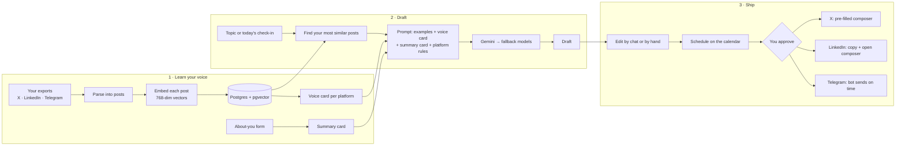

<div align="center">

# Voxlace

**Your voice, woven across every platform.**

Voxlace learns how you write from your own past posts and daily notes, then drafts posts for X, LinkedIn and Telegram that sound like you. You review, schedule and publish. It never posts without you.


[How it works](#how-it-works) · [Features](#features) · [Getting started](#getting-started) · [Roadmap](#roadmap) · [Docs](#documentation) · [Contributing](#contributing)

</div>

---

## Why Voxlace

Builders ship every day but rarely post about it. When they do, AI writing tools make them sound like everyone else, and every platform wants a different shape.

Voxlace starts from **your own writing**. It imports your exported posts, learns your voice per platform, and turns your real work and daily check-ins into drafts that fit X, LinkedIn and Telegram — in your words, your language and your rhythm.

| Most AI post tools | Voxlace |
|---|---|
| Generic voice from a prompt | Your voice, retrieved from your own posts |
| One post reshaped for every platform | A separate voice and rules per platform |
| Ideas from trends | Ideas from your actual work and check-ins |
| Posts for you | Drafts for you; you approve every post |

---

## How it works



**No model training.** Voxlace uses retrieval-augmented generation (RAG): at draft time it finds your closest past posts and shows them to the model as examples. Your data is only ever used for your own drafts.

---

## Features

### V1 core

- **Import** your X archive, LinkedIn archive and Telegram export
- **Voice cards** per platform with measured habits (length, emoji, hashtags)
- **About-you profile** that grounds every draft in facts you gave
- **Chat board** for daily check-ins and draft requests
- **Per-platform drafts** with a live, platform-correct length counter (X weighted counting included)
- **Revise by chat** ("make it punchier") with full version history
- **Draft library** with statuses: draft → approved → published / discarded
- **Calendar** to plan the week, with drag-to-reschedule
- **Telegram publishing** through a bot, sent at the scheduled time
- **One-click hand-off** to X and LinkedIn
- **Invite-only accounts** with per-user isolation enforced in the database
- **Model fallback chain** so drafts keep flowing when a free model fails
- **Daily usage limits**, privacy notice, and full data export and delete

### V1 stretch

GitHub activity as context · suggested posting windows by audience time zone · resume and website import with contact details stripped · idea inbox · metrics page

### Not in V1

Billing and teams · automatic posting to X and LinkedIn · trend feeds · AI images · model fine-tuning

---

## Tech stack

| Layer | Choice | Why |
|---|---|---|
| Backend | **FastAPI** · Pydantic · Uvicorn | Typed validation and auto-generated API docs that double as the frontend contract |
| Database | **PostgreSQL + pgvector** | One database for app data and embeddings |
| Migrations | SQLAlchemy · Alembic | Versioned schema changes both developers can run |
| AI | **Gemini** (`gemini-embedding-2` at 768 dims, Gemini Flash) + one free fallback provider | Free tier; one wrapper module so models are swapped in config |
| Frontend | **React + Vite + TypeScript** · React Router · TanStack Query · Tailwind CSS · FullCalendar | Types generated from the API contract; a calendar out of the box |
| Auth | Supabase Auth (login only) · Postgres row-level security | Managed login; isolation a code bug can't break |
| Publishing | Telegram Bot API · X web intent · LinkedIn composer | Zero platform API fees |
| Scheduling | Worker container (sends due posts every minute) | Always-on server, no external cron needed |
| Hosting | **Contabo VPS** · Docker Compose · Caddy (auto HTTPS) | Always on, no cold starts, one server for API, worker, database and frontend |
| Quality | pytest · Vitest · Ruff · Gitleaks · GitHub Actions | Same formatting, tests and a secret scan on every PR |
| CI/CD | GitHub Actions → SSH deploy to the server | Merge to `main` = deployed, with rollback on failure |
| Local dev | Docker Compose | One command for the database |

---

## Project structure

```text
post-generator/
├── backend/            FastAPI app + worker (Phase 0)
│   ├── app/
│   │   ├── api/        Route handlers
│   │   ├── ai/         Embedding + generation wrapper, fallback chain, prompts
│   │   ├── importers/  X, LinkedIn and Telegram parsers
│   │   ├── models/     SQLAlchemy models
│   │   ├── core/       Settings, auth, database session
│   │   └── worker.py   Sends due Telegram posts and reminders
│   ├── migrations/     Alembic
│   └── tests/
├── frontend/           React + Vite app (Phase 0)
├── samples/            Small anonymised export files for parser tests
├── docs/
│   ├── SRS.md          Requirements — the source of truth
│   ├── BUILD_PLAN.md   Phases, task split, cycles, tools
│   ├── API.md          Backend ↔ frontend contract
│   ├── CI_CD.md        Pipeline, branch protection, deploy setup
│   └── OPEN_QUESTIONS.md  Decisions still to make
├── .claude/            Claude Code settings, hooks and skills
├── CLAUDE.md           Rules for agentic development
├── deploy/             Production setup for the Contabo server (Phase 2)
├── docker-compose.yml  Local Postgres + pgvector
└── .env.example        Every setting the app reads
```

---

## Getting started

> **Status:** pre-alpha. The repo holds the plan and the local database setup. Backend and frontend land in Phase 0 — see [`BUILD_PLAN.md`](docs/BUILD_PLAN.md).

### Prerequisites

- Git
- Docker Desktop (or Docker Engine + Compose)
- Python 3.12+
- Node.js LTS
- A free [Gemini API key](https://aistudio.google.com/apikey)

### 1. Clone and configure

```bash
git clone https://github.com/fetehadin/post-generator.git
cd post-generator
cp .env.example .env        # then fill in your keys
```

### 2. Start the database

```bash
docker compose up -d
docker compose exec db psql -U voxlace -c "SELECT extname, extversion FROM pg_extension WHERE extname = 'vector';"
```

The `vector` extension is enabled automatically on first start.

> Port 5432 already taken by a local Postgres? Set `POSTGRES_PORT=5433` in `.env` and change the port in `DATABASE_URL` to match.

### 3. Run the backend *(from Phase 0)*

```bash
cd backend
python -m venv .venv && source .venv/bin/activate
pip install -e ".[dev]"
alembic upgrade head
uvicorn app.main:app --reload
```

API docs: <http://localhost:8000/docs>

### 4. Run the frontend *(from Phase 0)*

```bash
cd frontend
npm install
npm run dev
```

App: <http://localhost:5173>

### Run the checks

```bash
cd backend && ruff check . && ruff format --check . && pytest
cd frontend && npm test
```

---

## Configuration

All settings come from environment variables. See [`.env.example`](.env.example) for the full list.

| Variable | Purpose |
|---|---|
| `DATABASE_URL` | Postgres connection for the API (limited `voxlace_app` role) |
| `MIGRATIONS_DATABASE_URL` | Postgres connection for Alembic (owner role) |
| `POSTGRES_PORT` | Host port for the Docker database |
| `GEMINI_API_KEY` | Embeddings and generation |
| `EMBEDDING_MODEL` · `EMBEDDING_DIMENSIONS` | Fixed embedding model; never changed silently |
| `GENERATION_MODELS` | Ordered fallback chain, comma-separated `provider:model` |
| `FALLBACK_API_KEY` | Key for the second provider |
| `AUTH_JWT_SECRET` / `AUTH_JWKS_URL` | Login token verification |
| `TELEGRAM_BOT_TOKEN` | The app's Telegram bot |
| `WORKER_INTERVAL_SECONDS` | How often the worker checks for due posts |
| `DAILY_DRAFT_LIMIT` · `DAILY_EMBED_LIMIT` | Per-user quotas |

---

## Roadmap

Full detail in [`docs/BUILD_PLAN.md`](docs/BUILD_PLAN.md).

- [ ] **Phase 0 — Foundations:** repo, Docker Postgres + pgvector, FastAPI, React, CI
- [ ] **Phase 1 — Core voice loop:** Telegram import → embed → retrieve → draft
- [ ] **Phase 2 — Accounts and isolation:** login, invites, row-level security, first deploy to the server
- [ ] **Phase 3 — All platforms and voice:** X + LinkedIn import, voice cards, profile, settings
- [ ] **Phase 4 — Drafting workflow:** chat board, revisions, library, hand-off
- [ ] **Phase 5 — Calendar and Telegram publishing:** calendar, bot connect, scheduled sends
- [ ] **Phase 6 — SaaS hardening:** fallback models, limits, export/delete, backups, production deploy
- [ ] **Phase 7 — Private beta:** invited testers, publish-rate metrics

---

## Documentation

| Doc | What's in it |
|---|---|
| [Software Requirements Specification](docs/SRS.md) | Every requirement with a yes/no test, the data model, platform rules |
| [Build Plan](docs/BUILD_PLAN.md) | Build order, who does what, the cycle, tools by phase |
| [API Contract](docs/API.md) | Endpoints and JSON shapes |
| [CI/CD](docs/CI_CD.md) | Checks on every pull request, deploys to the server, GitHub setup |
| [Open Questions](docs/OPEN_QUESTIONS.md) | Design gaps to settle before and during each phase |
| [Contributing](CONTRIBUTING.md) | Branches, commits, reviews, definition of done |

---

## Building with Claude Code

The repo is set up for agentic development:

| File | What it does |
|---|---|
| [`CLAUDE.md`](CLAUDE.md) | Project rules every session loads: stack, commands, non-negotiable rules, workflow |
| [`backend/CLAUDE.md`](backend/CLAUDE.md) · [`frontend/CLAUDE.md`](frontend/CLAUDE.md) | Layer-specific conventions, loaded when Claude works in that folder |
| [`.claude/settings.json`](.claude/settings.json) | Permissions: safe commands allowed, pushes and deploys ask first, secrets denied |
| `.claude/hooks/` | Auto-format edited files; block shell commands that read `.env` |
| `.claude/skills/` | `/slice` build a feature end to end · `/check` run all checks · `/pr-check` review a branch · `/migration` create a migration |

Personal notes go in `CLAUDE.local.md` (git-ignored).

## Privacy

- Your posts are used **only** for your own drafts. Nothing is pooled across users.
- Only the posts file from each export is stored; the rest is discarded.
- Contact details are stripped from resumes before anything reaches the AI, and you review the result.
- Voxlace never asks for your social media passwords.
- You can export or delete all your data at any time.
- During the beta, Voxlace uses Gemini's free tier, which may use submitted data to improve Google's products. Testers are told before they upload.

---

## Contributing

Two-person team, one rule: **every change goes through a pull request reviewed by the other person.** Read [`CONTRIBUTING.md`](CONTRIBUTING.md) before your first PR.

## Team

| | Role |
|---|---|
| **Fetehadin Negash** | Co-founder · starts on Data & AI |
| **Nezira** | Co-founder · starts on App & Platform |

## License

Not chosen yet. All rights reserved until a license file is added.

<div align="center">
<sub>Built in public by two builders who wanted to post more and sound like themselves.</sub>
</div>
