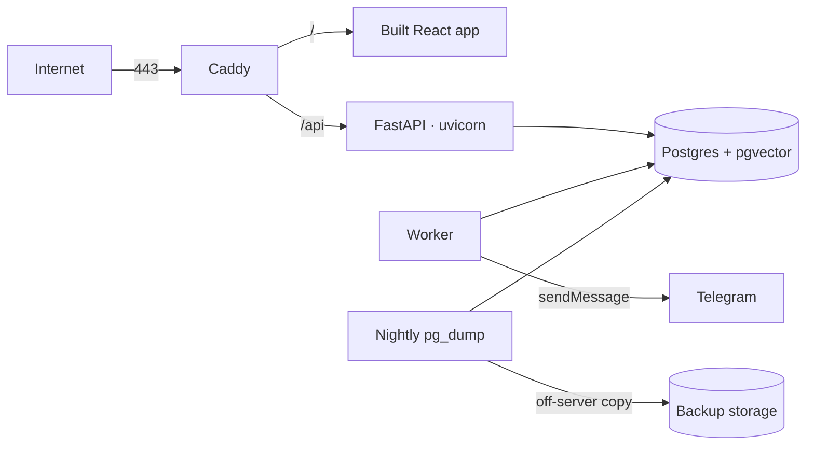
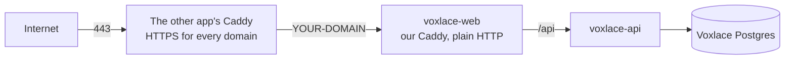

# Deploy (Contabo VPS)

Production runs on one Contabo VPS with Docker Compose. Prepared in **Phase 2** — see [`docs/BUILD_PLAN.md`](../docs/BUILD_PLAN.md#phase-2--accounts-and-isolation).

## Target layout



| Service | Image / source | Exposed |
|---|---|---|
| `caddy` | `caddy:2` + `Caddyfile` | 80, 443 |
| `api` | `backend/Dockerfile` | internal only |
| `worker` | `backend/Dockerfile`, command `python -m app.worker` | none |
| `db` | `pgvector/pgvector:pg18` | none (never public) |

## Files

| File | What |
|---|---|
| `docker-compose.prod.yml` | `caddy`, `api` and `db`, all `restart: unless-stopped`. Only Caddy publishes ports. The worker joins in Phase 5. |
| `Caddy.Dockerfile` | Builds the React app (with the public Supabase URL and key), then serves it with Caddy |
| `Caddyfile` | `{$DOMAIN}`: automatic HTTPS, security headers, `/api/*` → `api:8000`, everything else → the app |
| `../backend/Dockerfile` | The API image (non-root user) |
| `server-env.template` | Every setting the server needs. Copy it to the server's `deploy/.env` and fill it in |
| `backup.sh` | `pg_dump` → gzip → off-server copy to `$BACKUP_REMOTE`; keeps 14 days |
| `deploy.sh` | Run by the deploy workflow over SSH: build, migrate, restart; rolls back on failure |

## First deploy: step by step

Do this once, as a person with access to the server, the domain and the GitHub repo settings.

**1. Server (Ubuntu, as root once):**

```bash
sed -i 's/^#\?PasswordAuthentication .*/PasswordAuthentication no/; s/^#\?PermitRootLogin .*/PermitRootLogin no/' /etc/ssh/sshd_config
systemctl restart ssh
ufw allow 22 && ufw allow 80 && ufw allow 443 && ufw --force enable
apt update && apt install -y unattended-upgrades rsync git && dpkg-reconfigure -plow unattended-upgrades
curl -fsSL https://get.docker.com | sh
./add-deploy-user.sh     # from this repo's deploy/ folder: the deploy user (Docker, no sudo) and /srv/voxlace
```

The `deploy` user has **no sudo**: GitHub Actions logs in as it, so a leaked CI key must not mean root. Do admin work as root or your own user. Before turning password login off, check `ssh deploy@YOUR-SERVER` works from your laptop.

**2. Domain:** add an `A` record for your domain pointing at the server's IP.

**3. Supabase** (free project, login only):
- **Authentication → Providers:** Email on.
- **URL configuration:** Site URL `https://YOUR-DOMAIN`.
- **Project settings → API:** copy the URL and the publishable key.

**4. The app (as `deploy`):**

```bash
git clone https://github.com/fetehadin/post-generator.git /srv/voxlace && cd /srv/voxlace
cp deploy/server-env.template deploy/.env && nano deploy/.env     # fill in every value
./deploy/deploy.sh "$(git rev-parse HEAD)"                        # build, migrate, start
```

Open `https://YOUR-DOMAIN`. Caddy gets the HTTPS certificate on the first visit.

**5. Invite yourself** (or put your email in `ALLOWED_EMAILS`):

```bash
docker compose -f deploy/docker-compose.prod.yml --env-file deploy/.env exec api \
  python -m app.dev invite --email you@example.com
```

**6. Backups:** `crontab -e`, then add:

```cron
15 3 * * * cd /srv/voxlace && ./deploy/backup.sh >> /home/deploy/backup.log 2>&1
```

Run it once by hand, and test a restore once (the command is at the bottom of `backup.sh`).

**7. Deploy on every merge to `main`:** in GitHub → Settings → Environments → `production`:
- secrets `DEPLOY_SSH_KEY` (a key that only this workflow uses), `DEPLOY_KNOWN_HOSTS` (`ssh-keyscan YOUR-SERVER`), `DEPLOY_USER` (`deploy`) and `DEPLOY_HOST`;
- variables `DEPLOY_PATH` (`/srv/voxlace`) and `DOMAIN` (the health check calls `https://$DOMAIN/api/v1/health`);
- then the repository variable `DEPLOY_ENABLED` = `true`. See `docs/CI_CD.md`.

**Our server, the short way:** copy `deploy/local.env.example` to `deploy/local.env` (git-ignored) and put the server's address and domain in it. Then `./deploy/finish-setup.sh` from the repo root on your laptop does steps 4–7's
remaining parts in one go. It copies the AI and login keys from your local settings file to the server
(`push-keys.sh`, values never printed), sets the GitHub secrets and variables above, starts Voxlace, and
turns `DEPLOY_ENABLED` on only after the health check passes.

## Sharing the server with another Caddy (our Contabo box)

Our server already runs another app whose Caddy owns ports 80 and 443 for every site on it. Only one
program can listen on a port, so Voxlace's Caddy steps back:



- `docker-compose.shared-caddy.yml` removes our Caddy's ports, swaps in `Caddyfile.internal` (plain
  HTTP on :80), and joins the shared network (`SHARED_NETWORK` in the server settings) as `voxlace-web`.
- Our API is called `voxlace-api` there, because the other app's network already has an `api`.
- The database and the API never join the shared network.
- Set `SHARED_CADDY=true` and `SHARED_NETWORK` in the server settings file (Compose 2.24+); `deploy.sh` then adds the override itself.

Add this block to the other app's Caddyfile, then reload that Caddy:

```caddy
YOUR-DOMAIN {
	encode zstd gzip
	header -Server
	reverse_proxy voxlace-web:80
}
```

```bash
cd /path/to/the-other-app
docker compose exec caddy caddy validate --config /etc/caddy/Caddyfile
docker compose exec caddy caddy reload --config /etc/caddy/Caddyfile
```

Until Voxlace is running, the domain returns 502; the other sites aren't affected. If the other app ever
rebuilds its network, run `./deploy/deploy.sh "$(git rev-parse HEAD)"` again so our Caddy rejoins it.

## Server checklist (once)

- [ ] `deploy` user with Docker and no sudo (`add-deploy-user.sh`); SSH key login only; password login off. **The script leaves sshd and `ufw` alone: these two lines stay open until you do them by hand (NFR-18).**
- [ ] `ufw` allows 22, 80, 443 only
- [ ] Unattended security upgrades on
- [ ] Docker + Compose plugin installed
- [ ] Domain A record points at the server
- [ ] Nightly backup cron entry; restore tested once
