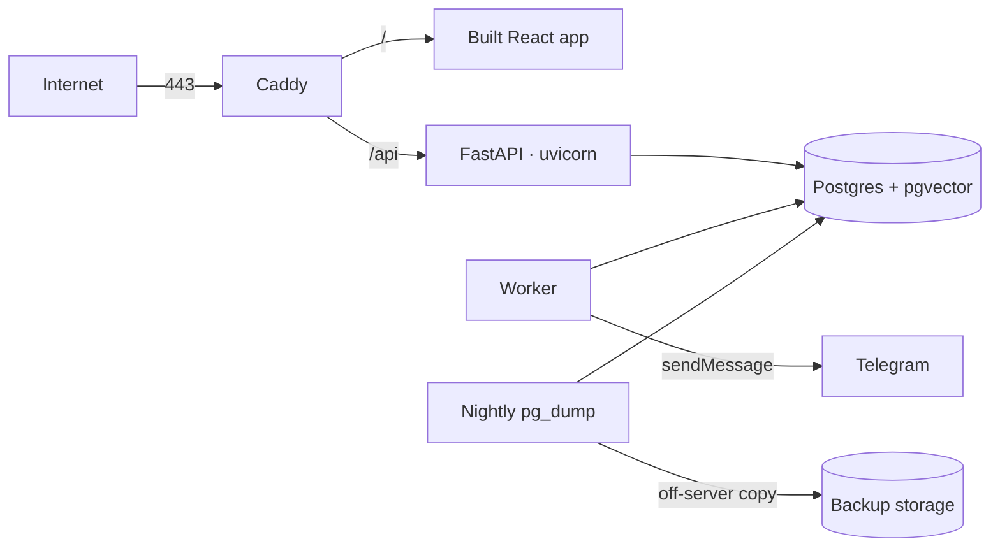

# Deploy (Contabo VPS)

Production runs on one Contabo VPS with Docker Compose. Built in **Phase 2** — see [`docs/BUILD_PLAN.md`](../docs/BUILD_PLAN.md#phase-2--accounts-and-isolation).

## Target layout

| Service | Image / source | Exposed |
|---|---|---|
| `caddy` | `caddy:2` + `Caddyfile` | 80, 443 |
| `api` | `backend/Dockerfile` | internal only |
| `worker` | `backend/Dockerfile`, command `python -m app.worker` | none |
| `db` | `pgvector/pgvector:pg18` | none (never public) |

## Files to add in Phase 2

- `docker-compose.prod.yml` — the four services above, all `restart: unless-stopped`
- `Caddyfile` — `{$DOMAIN}` serves `/srv/frontend`, proxies `/api/*` to `api:8000`
- `backup.sh` — `pg_dump` → gzip → copy to `$BACKUP_REMOTE`, keep 14 days
- `.env` on the server only (never committed)

## Server checklist (once)

- [ ] Non-root user with sudo; SSH key login only; password login off
- [ ] `ufw` allows 22, 80, 443 only
- [ ] Unattended security upgrades on
- [ ] Docker + Compose plugin installed
- [ ] Domain A record points at the server
- [ ] Nightly backup cron entry; restore tested once
