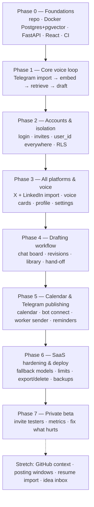
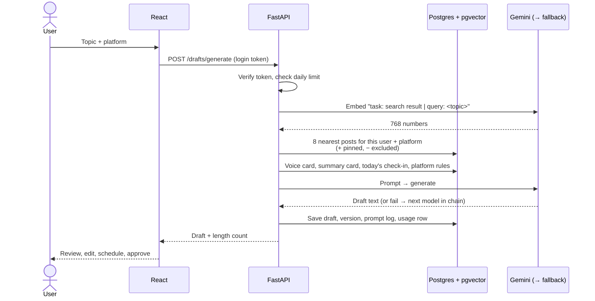
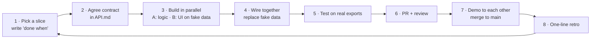

# Build Plan — Voxlace V1

How two developers take Voxlace from an empty repo to a private beta. It covers the order to build in, who does what, how each cycle runs, and which tools you meet along the way.

> You don't need to understand every phase today. Read the **big picture** once, then only read the phase you're in. Each phase teaches you what the next one needs.

---

## Contents

1. [The big picture](#1-the-big-picture)
2. [The two tracks (who does what)](#2-the-two-tracks-who-does-what)
3. [The phases](#3-the-phases)
4. [How a cycle works](#4-how-a-cycle-works)
5. [Git and GitHub workflow](#5-git-and-github-workflow)
6. [Definition of done](#6-definition-of-done)
7. [Tools you'll use, by phase](#7-tools-youll-use-by-phase)
8. [Learn just in time](#8-learn-just-in-time)
9. [Risks to watch](#9-risks-to-watch)

---

## 1. The big picture

### What you're building, in one paragraph

A user uploads their old posts. The backend splits them into rows, turns each into an **embedding** (768 numbers that capture meaning) and stores it in **Postgres + pgvector**. When the user asks for a draft, the backend embeds the topic, finds their most similar past posts, and builds a prompt from four things: those examples, their voice card, today's check-in, and the platform's rules. It sends that prompt to **Gemini**, saves the draft, and shows it in **React**. The user edits it, schedules it on the calendar and approves it. X and LinkedIn get a hand-off; Telegram is sent by the bot: a **worker** running beside the API on your Contabo server checks every minute and sends scheduled posts on time.

### The order you build in

You build **bottom-up through the data, but in thin end-to-end slices**: database first, then the AI loop on one platform, then accounts, then everything else.

**Why this order:**

- **Phase 1 is the riskiest part.** If drafts don't sound like you, nothing else matters. Prove it early, with no UI polish.
- **Accounts come before the second platform**, so `user_id` and row-level security are in place before tables multiply.
- **Publishing comes late** because it only matters once drafts are good.
- **Deploy happens before the beta, not at the very end of everything.** Do a first deploy to the Contabo server in Phase 2 so hosting surprises show up early.

### What happens when a user clicks "Generate"

---

## 2. The two tracks (who does what)

Split so that each track has about the same amount of work. **Track A owns the backend of every feature** (database, API endpoints, AI, worker). **Track B owns everything the user touches, plus login and the server.** The API contract in [`API.md`](API.md) is the line between them.

| Track | Owns | Starts with |
|---|---|---|
| **A — Backend & AI** | Database models and migrations, RLS policies, API endpoints for imports and drafts, parsers, embeddings, retrieval, prompts, voice cards, smart inspiration, draft chat, model fallback, the worker (scheduled sends and reminders) | **Fetehadin** |
| **B — Frontend & Platform** | FastAPI skeleton and error handling, Supabase login and JWT check, every React screen (setup, chat board, draft editor, calendar, profile, settings), Telegram connect flow, CI, server and deploy, backups | **Nezira** |
| **Together** | The API contract for each slice, schema reviews, demos, reviews | Both |

**Rules for the split**

1. **Swap tracks after Phase 3.** Both of you should be able to explain the whole system by the beta.
2. **Every pull request is reviewed by the other person.** That's how each of you learns the other track.
3. **Schema changes are reviewed by both.** Track A writes the Alembic migration; Track B reviews it before anyone builds on it.
4. **The API contract comes first.** Agree request/response shapes in [`API.md`](API.md) before coding a slice. Track B builds the screen against fake data while Track A builds the endpoint and logic.
5. **Blocked for more than an hour? Say so.** Pair on it instead of waiting.

---

## 3. The phases

Each phase lists its goal, the tables it adds, the tasks per track, and a **demo** that proves it's done. Don't start the next phase until the demo works on your own real data.

### Phase 0 — Foundations

**Goal:** both of you can clone the repo, run one command, and see the API and the React app talking to a local database.

**Database:** `pgvector/pgvector:pg18` in Docker (done), the `voxlace_app` role (done), first Alembic migration with `users`, `imports` and `source_posts`.

**Already done (15–17 Oct):** exports, Gemini key, throwaway embedding test on 428 real posts, sample exports, local database + app role, CI fixes, labels, protected `main`, the clickable prototype ([`docs/prototype/`](prototype/index.html)).

| Track A — Backend & AI (Fetehadin) | Track B — Frontend & Platform (Nezira) |
|---|---|
| `backend/pyproject.toml` with dependencies, Ruff and pytest config | FastAPI app factory with `/health` (API + DB check) and the shared error shape from `API.md` |
| `core/config.py` (settings from `.env`) and `core/db.py` (engine, session) | React + Vite + TypeScript app (Tailwind, React Router, TanStack Query) with one page that calls `/health` |
| SQLAlchemy models + Alembic set up; first migration (`users`, `imports`, `source_posts`) | Make CI's backend and frontend jobs pass; uncomment pip/npm in `dependabot.yml` |
| `ai/client.py`: `embed_documents()`, `embed_query()`, `generate()` with retries, model names from config | Projects board with this week's issues |

**Together:** confirm SRS 1.2, write the Phase 1 API contract (`/imports`, `/posts`, `/drafts/generate`), agree on folder structure.

**Demo:** fresh clone → `docker compose up -d` → backend and frontend running → browser shows "API: ok, DB: ok".

---

### Phase 1 — Core voice loop (Telegram only)

**Goal:** upload your Telegram export and get a draft that sounds like you. No login yet: use one hard-coded dev user, but **put `user_id` on every row anyway**.

**Database:** `source_posts.embedding vector(768)`; add `drafts`, `draft_versions`, `prompt_logs`.

| Track A — Backend & AI (Fetehadin) | Track B — Frontend & Platform (Nezira) |
|---|---|
| Telegram parser: flatten text, skip forwards/service/empty/link-only and excluded hashtags (FR-44) | Upload page: pick platform, upload, live progress and counts, readable errors |
| Dedupe on `(user_id, platform, external_id)`; reject malformed files atomically | Generate page: topic box → draft card with character count |
| `POST /imports` + `GET /imports/{id}`: best ~1,000 first, resumable embedding queue | Posts list page using `GET /posts` with paging |
| Retrieval: 8 closest posts, no near-duplicates; prompt builder; `POST /drafts/generate`; prompt logs | Prompt log debug view for a draft |
| `GET /posts` with paging · **ten fixed test topics** you re-run after every prompt change | Request logging and friendly error pages in the frontend |

**Demo:** upload your real Telegram export → see "415 posts imported" → type a topic → get a draft you'd actually post.

> If drafts sound generic, stay here. Tune retrieval count, examples and prompt wording until they don't.

---

### Phase 2 — Accounts and isolation

**Goal:** real login, invite-only, and no way for one user to see another's data.

**Database:** `invites`, `profiles` (empty shell), privacy acceptance on `users`, **row-level security** on every user table.

| Track A — Backend & AI (Fetehadin) | Track B — Frontend & Platform (Nezira) |
|---|---|
| RLS policies on every user table, in migrations | Supabase Auth: Google or email code, stay logged in until log out |
| `SET LOCAL app.user_id` per request in `core/db.py` | Backend dependency that verifies the JWT on every route (401 if missing) |
| Two-user tests as `voxlace_app`: B never sees A's posts, drafts or prompt logs | Invite codes; privacy notice screen; uploads blocked until accepted |
| Replace the dev user with the real `user_id` everywhere | **First deploy to Contabo** (SSH keys only, `ufw`, Caddy, prod compose) and the deploy workflow |

**Demo:** two accounts, each imports their own export; neither can reach the other's posts by UI or by calling the API directly.

---

### Phase 3 — All platforms and voice

**Goal:** X and LinkedIn work like Telegram, each platform has its own voice and rules, and inspiration is picked automatically.

**Database:** `voice_cards`, `platform_profiles` (seeded), `platform_settings`, full `profiles`, `exemplar_posts`, `inspiration_posts`.

| Track A — Backend & AI (Fetehadin) | Track B — Frontend & Platform (Nezira) |
|---|---|
| X parser (wrapper, threads kept, replies to others skipped) and LinkedIn parser | Setup flow: privacy → about you → audience → import → your voice → first draft |
| Weighted X counter with shared test cases (used by both backend and frontend) | Profile page: edit any section any time; summary card refreshes |
| Voice card + stats per platform; summary card; endpoints for profile and voice cards | Settings: tab per platform (rules, voice card, excluded hashtags, pinned posts) |
| **Smart inspiration (FR-41):** post-type detection, a separate inspiration pool per platform (Telegram channels, X accounts, LinkedIn creators), structure examples | Live length counter; pin / exclude buttons; inspiration chip in the editor |

**Demo:** the same topic produces three clearly different drafts — a tight X post, a LinkedIn post with a strong first line, a Telegram post — each in your voice, and a launch post shows a launch-strong creator's structure.

**→ Swap tracks after this phase.**

---

### Phase 4 — Drafting workflow

**Goal:** the daily loop feels good: write a check-in, get drafts, improve them by chatting, keep a library.

**Database:** `checkins`, `draft_messages`.

| Track A — Backend & AI | Track B — Frontend & Platform |
|---|---|
| Draft chat (FR-40): conversation endpoint, revise a selected sentence, convert to another platform, ask instead of inventing | Chat board: check-ins and draft requests in one stream with history |
| Facts guard: only facts from summary card, check-in, approved items | Draft editor with chat panel, hand edits, version history |
| Check-in endpoints; record edit distance between first and final version | Draft library with status filters |
| Published drafts saved back as source posts (`origin = voxlace`) | Hand-off: X pre-filled link, LinkedIn copy + open composer, mark as published |

**Demo:** write today's check-in → generate for all three → chat "make it punchier" twice → approve → X opens pre-filled with the right text.

---

### Phase 5 — Calendar, Telegram publishing and reminders

**Goal:** plan the week on a calendar; Telegram posts go out on time; Voxlace reminds you to check in.

**Database:** `telegram_connections`, `reminder_settings`; `drafts.scheduled_for`, `reminder_sent_at`, `published_at` in use.

| Track A — Backend & AI | Track B — Frontend & Platform |
|---|---|
| `worker.py`: every minute, send approved due Telegram posts; lock rows so a restart never double-sends | Calendar: week and month views, drag to reschedule (store UTC, show local) |
| Daily check-in reminders (FR-42), skipped when today already has a check-in | Telegram connect flow: bot as admin → `getChatMember` check → save |
| Reply to the bot = check-in, draft sent back (FR-43) | Reminder settings screen; in-app notifications; "Publish now" |
| Retry and record failures | Worker service in the production compose file |

**Demo:** approve a Telegram draft for 5 minutes from now and close the laptop: it appears in your channel on time. At 20:00 the bot asks "What did you build today?"; your reply becomes a check-in.

---

### Phase 6 — SaaS hardening and deploy

**Goal:** safe to hand to other people on free tiers.

**Database:** `provider_usage`, `uploads` (if doing resume import later).

| Track A — Backend & AI | Track B — Frontend & Platform |
|---|---|
| Model fallback chain from config; record model + provider per draft | Daily limits shown in the app; clear 429 message, input kept |
| Embedding retry queue; never switch embedding models | Export my data (JSON) and delete all my data (screens) |
| Daily health check of each model; run the ten test topics on every fallback | Production env vars, CORS, error pages, uptime check |
| Export and delete endpoints; usage limits enforced in the API | Nightly `pg_dump` copied off the server; test a restore (NFR-17) |

**Demo:** turn off the first model in config → drafts still arrive from the second and say so; delete a test account → every row is gone.

---

### Phase 7 — Private beta

**Goal:** learn whether real people publish what Voxlace writes.

| Track A | Track B |
|---|---|
| Metrics: publish rate and edit intensity per user per week | Invite 5–10 testers; onboarding guide on getting exports |
| Read weak drafts' prompt logs weekly; fix prompts | Feedback form; fix the top three pain points each week |

**Set the bar before inviting anyone**, for example "40% of drafts published by week 3". Decide afterwards whether to build stretch features or rework the core.

---

### Stretch (after the core works)

GitHub context (FR-14) · suggested posting windows (FR-16, FR-34) · resume and website import with contact stripping (FR-20, FR-21, NFR-12) · streak and catch-up nudges · idea inbox · metrics page.

---

## 4. How a cycle works

### The slice cycle (a few days each)

Every phase is cut into **slices**: small features that work end to end.

### The week

| When | What | Time |
|---|---|---|
| Start of week | Pick the slices for the week from the board; each gets an owner and a "done when" | 30 min |
| Every day | Sync: done yesterday, doing today, blocked on | 10 min |
| Mid-week | Re-run the ten test topics if prompts changed | 15 min |
| End of week | Demo on your own data, then retro: keep / change / try | 30 min |

### Work-in-progress limits

- **One slice in progress per person.** Finish before starting another.
- **Ideas mid-slice go to a "Later" column**, not into the code.
- **A slice that grows past a week gets split.**

---

## 5. Git and GitHub workflow

| Thing | Rule |
|---|---|
| `main` | Always runs. Protected: no direct pushes, CI must pass, one approval. |
| Branches | `feat/telegram-parser`, `fix/x-counter-emoji`, `chore/ci-ruff`, `docs/api-imports` |
| Commits | Small, present tense, say why: `feat(import): skip Telegram service messages` |
| Pull requests | Under ~400 changed lines; link the issue; fill in the template; screenshot UI changes |
| Merging | Squash merge; delete the branch |
| Issues | One per task, with a **Done when** line, a track label and a phase label |
| Labels | `track:data-ai`, `track:app`, `phase:0`…`phase:7`, `type:feature`, `type:bug`, `type:chore` |
| Board columns | Backlog → This week → In progress → In review → Done · plus **Later** |

---

## 6. Definition of done

A task is done when **all** of these are true:

- [ ] It does what its "Done when" line says, checked on real data.
- [ ] Tests cover the logic (parsers, counters, retrieval filters, auth checks).
- [ ] CI is green.
- [ ] The other person reviewed and approved the PR.
- [ ] No secrets, personal data or real exports committed.
- [ ] `API.md`, the SRS or the README is updated if the change affects them.
- [ ] It's merged to `main`, and `main` still runs from a fresh clone.

---

## 7. Tools you'll use, by phase

| Phase | Tools |
|---|---|
| 0 | Git, GitHub (Issues, Projects, Actions), Docker + Compose, PostgreSQL + pgvector, Python 3.12, FastAPI, Uvicorn, Pydantic, SQLAlchemy, Alembic, Ruff, pytest, pre-commit, Node LTS, React, Vite, TypeScript, Tailwind CSS, TanStack Query, Vitest, Claude Code with the repo's `CLAUDE.md` files |
| 1 | `google-genai` SDK (`gemini-embedding-2`, Gemini Flash), `pgvector` Python package, Python `json`, FastAPI file uploads |
| 2 | Supabase Auth (login only), JWT verification (`PyJWT`), Postgres row-level security, Contabo VPS, `ufw`, Caddy, production Docker Compose, GitHub Actions deploy over SSH |
| 3 | Python `csv`, Unicode handling for the weighted counter, React forms |
| 4 | Clipboard API, X web intent URLs |
| 5 | FullCalendar (or a simple week grid), Telegram Bot API via `httpx`, a worker process (plain loop or APScheduler) |
| 6 | Second AI provider (Groq, OpenRouter or Mistral), structured logging |
| 7 | Simple metrics queries, a feedback form |
| Stretch | GitHub REST API, `pypdf` / `python-docx`, regex-based contact stripping |

---

## 8. Learn just in time

Learn each topic in the week you need it, by building.

| Before phase | Learn |
|---|---|
| 0 | FastAPI basics (routes, Pydantic models, dependencies) — the Flask course carries over · Docker Compose · Alembic migrations |
| 1 | What embeddings are · cosine distance · pgvector queries · prompt structure with examples (few-shot) |
| 2 | How JWT login works · Postgres row-level security · Linux server basics (SSH keys, firewall) · Caddy reverse proxy |
| 3 | Pandas-free CSV parsing · Unicode and grapheme counting |
| 5 | Time zones (store UTC, display local) · idempotent jobs (safe to run twice) |
| 6 | Retries with backoff · rate limits · fallback patterns |

---

## 9. Risks to watch

| Risk | Early sign | What to do |
|---|---|---|
| Drafts sound generic | You rewrite most of each draft in Phase 1 | Stay in Phase 1; tune examples, count and prompt with the ten test topics |
| Free AI quota runs out | 429s during testing | Embed each post once, cache, back off; add per-user limits early |
| A free model disappears | Fallback fires daily | Keep the chain in config; run the daily health check |
| Scope creep | "Quick" features mid-slice | "Later" column; only the current slice gets built |
| Data leak between users | — | RLS + two-user tests in CI from Phase 2 |
| Server goes down or disk fills | Missed sends, failed uploads | Uptime check, `restart: unless-stopped`, disk alerts, nightly off-server backups |
| One person becomes the bottleneck | PRs wait > 1 day | Review before starting new work; swap tracks after Phase 3 |
