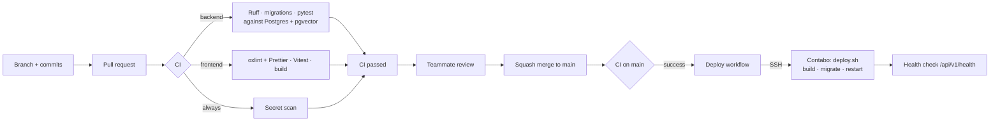

# CI/CD — Voxlace

How code gets from a branch to the Contabo server. **CI** checks every change automatically. **CD** deploys `main` to the server after CI passes.



## The files

| File | What it does |
|---|---|
| `.github/workflows/ci.yml` | Runs on every pull request and every push to `main` |
| `.github/workflows/deploy.yml` | Runs after CI succeeds on `main`, or by hand. Off until enabled. |
| `deploy/deploy.sh` | Runs on the server: checks out the commit, builds, migrates, restarts, and rolls back if a step fails |
| `.github/dependabot.yml` | Weekly pull requests to update GitHub Actions (and Python/npm packages from Phase 0) |

## CI jobs

| Job | Runs when | Checks |
|---|---|---|
| Detect project parts | Always | Whether `backend/pyproject.toml` and `frontend/package-lock.json` exist yet |
| Backend | Backend exists | `ruff check`, `ruff format --check`, `alembic upgrade head` on a fresh pgvector database, `pytest` |
| Frontend | Frontend exists | `npm run lint`, `npm test`, `npm run build` (includes the TypeScript check) |
| Secret scan | Always | [Gitleaks](https://github.com/gitleaks/gitleaks) looks for keys and tokens in the code and history |
| **CI passed** | Always | One summary check: fails if any job above failed. **Require this one** in branch protection. |

Until Phase 0 adds code, the backend and frontend jobs are skipped and CI stays green.

## Set up once (GitHub settings)

### 1. Protect `main` (do this now)

**Settings → Branches → Add branch ruleset** (or classic branch protection) for `main`:

- [ ] Require a pull request before merging, with **1 approval**
- [ ] Require status checks to pass → add **CI passed**
- [ ] Require branches to be up to date before merging
- [ ] Block force pushes and deletions
- [ ] Allow **squash merge** only (Settings → General → Pull Requests)

### 2. Enable deploys (Phase 2, once `deploy/docker-compose.prod.yml` exists)

On the server, once:

```bash
sudo adduser --disabled-password deploy && sudo usermod -aG docker deploy
sudo -u deploy git clone https://github.com/fetehadin/post-generator /opt/voxlace
# put the production deploy/.env in /opt/voxlace/deploy/.env (never commit it)
```

Make a key used **only** for deploys and add its public half to the server:

```bash
ssh-keygen -t ed25519 -f voxlace_deploy -N "" -C "github-actions-deploy"
ssh-copy-id -i voxlace_deploy.pub deploy@YOUR_SERVER_IP
ssh-keyscan YOUR_SERVER_IP      # copy the output for DEPLOY_KNOWN_HOSTS
```

Then in GitHub, **Settings → Environments → New environment → `production`**. Optionally add yourselves as required reviewers so every deploy waits for a click. Add:

| Type | Name | Value |
|---|---|---|
| Secret | `DEPLOY_SSH_KEY` | Contents of `voxlace_deploy` (the private key) |
| Secret | `DEPLOY_KNOWN_HOSTS` | Output of `ssh-keyscan` |
| Secret | `DEPLOY_USER` | `deploy` |
| Secret | `DEPLOY_HOST` | Server IP or hostname |
| Variable | `DEPLOY_PATH` | `/opt/voxlace` |
| Variable | `DOMAIN` | Your domain, e.g. `voxlace.com` |
| Variable (repository) | `DEPLOY_ENABLED` | `true` — this switches deploys on |

Delete the local `voxlace_deploy` files once the secret is saved.

## Rules

- **CI must be green to merge.** Fix the cause; don't skip tests or weaken checks to get green.
- **Migrations must be backward-compatible.** `deploy.sh` rolls back the code if a step fails, but not the database. Add columns first and remove old ones in a later release.
- **Workflows are infrastructure.** Changes to `.github/workflows/` or `deploy/` need a review from the other person and are always "ask first" for Claude Code.
- **Secrets live only in GitHub Secrets and the server's `deploy/.env`.** Never in the repo, logs or chat.
- **Deploy by hand** from **Actions → Deploy → Run workflow** if you need to redeploy without a new commit.

## When something fails

| Symptom | Where to look |
|---|---|
| A CI job is red | Click the job in the PR's **Checks** tab; the failing step shows the exact command and output. Run the same command locally. |
| Secret scan fails | Remove the secret from the code, **rotate the key** (it's already exposed in history), then push. |
| Deploy fails at SSH | Check `DEPLOY_HOST`, `DEPLOY_USER`, `DEPLOY_KNOWN_HOSTS`, and that the public key is in `~deploy/.ssh/authorized_keys`. |
| Deploy succeeds but health check fails | `ssh deploy@server`, then `docker compose -f deploy/docker-compose.prod.yml logs api --tail 100`. |
