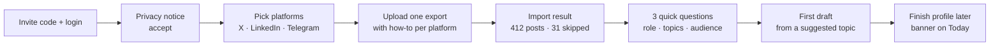
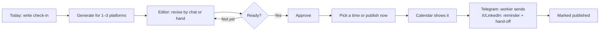
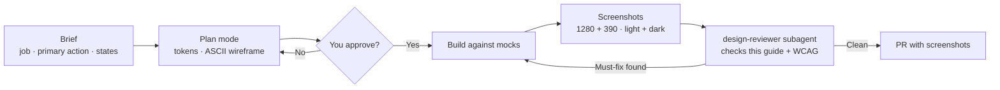

# Design Guide — Voxlace

How Voxlace should look, feel and behave, and how to design it with Claude Code. Read this before building any screen. Requirements still live in [`SRS.md`](SRS.md); this guide says how to present them.

> **The one idea behind every screen:** the user is the author, Voxlace is the drafter. Every screen should make it obvious what the AI wrote, why, and what will happen when the user clicks.

---

## Contents

1. [Design principles](#1-design-principles)
2. [Information architecture](#2-information-architecture)
3. [Core flows](#3-core-flows)
4. [Screen specs](#4-screen-specs)
5. [Visual direction](#5-visual-direction)
6. [Components](#6-components)
7. [States: loading, empty, error](#7-states-loading-empty-error)
8. [Writing in the interface](#8-writing-in-the-interface)
9. [Accessibility](#9-accessibility)
10. [Responsive and motion](#10-responsive-and-motion)
11. [Designing with Claude Code](#11-designing-with-claude-code)
12. [Design QA checklist](#12-design-qa-checklist)
13. [Sources](#13-sources)

---

## 1. Design principles

Grounded in Microsoft's 18 Guidelines for Human-AI Interaction (G1–G18) and research on editing text with LLMs.

| # | Principle | What it means on screen | Grounded in |
|---|---|---|---|
| 1 | **You're the author** | Nothing leaves the app without an explicit Approve or Publish click. The button says exactly what happens: "Publish to Telegram now", not "Submit". | G16 (convey consequences), FR-12, NFR-6 |
| 2 | **Show your sources** | Every draft shows which of your past posts shaped it ("Based on 8 of your posts") and opens them on click. | G11 (explain why) |
| 3 | **Be honest about quality** | Show voice strength per platform from post count ("12 posts: voice is still learning"). Never promise a perfect match. | G1–G2 (what it can do, how well), FR-5 |
| 4 | **Fix in one click** | Quick revisions (Shorter, Punchier, More casual) sit next to a free-text "Tell it what to change" box. People use both. | G9 (efficient correction); toolbar + free-prompt study |
| 5 | **Preview the real thing** | Drafts render the way each platform shows them: X's limit and line breaks, LinkedIn's "see more" fold at about 210 characters. | Platform rules, FR-9 |
| 6 | **Never lose input** | A failed or slow generation keeps the topic, check-in and edits exactly where they were. | NFR-4 |
| 7 | **Remember, then adapt slowly** | Recent topics and check-ins stay one click away. Voice cards change only when the user regenerates or edits them. | G12–G14, FR-26 |
| 8 | **Calm by default** | One accent color, one place for boldness: the draft. The interface recedes so the user's words stand out. | Frontend aesthetics guidance |

---

## 2. Information architecture

Five places in a left sidebar on desktop, a bottom bar on mobile. Each maps to SRS requirements.

| Nav item | Purpose | Requirements |
|---|---|---|
| **Today** | Chat board: write a check-in, ask for drafts, see today's drafts | FR-6, FR-7, FR-8 |
| **Drafts** | Library of every draft by status and platform; opens the editor | FR-10, FR-11 |
| **Calendar** | Week and month plan; due posts; Telegram sends | FR-13, FR-35 |
| **Voice** | Per-platform voice card, stats, pinned and excluded posts, imports | FR-1, FR-5, FR-22, FR-25, FR-26 |
| **Settings** | Profile, audience, language, Telegram connection, usage, export/delete | FR-17, FR-24, FR-30, FR-33, FR-36, FR-38 |

The **draft editor** isn't a nav item. It opens from Today, Drafts or Calendar as a full page (`/drafts/:id`), so every draft has a shareable URL and the back button works.

---

## 3. Core flows

### First run: from sign-up to first draft in under 5 minutes

Activation is a success metric (SRS §9), so onboarding asks only what the first draft needs. Everything else can wait.



- Upload **one** export to start. The others can be added from Voice.
- The export how-to opens beside the upload box: steps, screenshots and "takes about a day" for LinkedIn.
- The first topic is suggested ("Write about what you're building this week") so the user doesn't face a blank box.

### Daily loop



---

## 4. Screen specs

Wireframes show layout and hierarchy, not final styling.

### 4.1 Today (chat board)

The home screen. A single stream: check-ins, draft requests and draft cards in time order.

```
┌ Sidebar ┐┌──────────────────────────────────────────────────────┐
│ Today   ││  Wed 21 Oct                                          │
│ Drafts  ││  ┌ Check-in ──────────────────────────────────────┐  │
│ Calendar││  │ Finished the Telegram importer, 412 posts in.  │  │
│ Voice   ││  └────────────────────────────────────────────────┘  │
│ Settings││  ┌ Draft · X ─────────── 214/280 ─ Draft ┐            │
│         ││  │ Small win today: …                    │ Open       │
│ Usage   ││  └───────────────────────────────────────┘            │
│ 12/30   ││  ┌───────────────────────────────────────────────┐   │
│         ││  │ What did you work on today?                   │   │
│         ││  │ [X] [LinkedIn] [Telegram]   Save · Generate   │   │
└─────────┘└──└───────────────────────────────────────────────┘───┘
```

- **Composer pinned to the bottom**, with platform toggles and two actions: **Save check-in** and **Generate drafts**.
- Prompt starters above an empty composer: "What did you ship today?", "A lesson from this week", "Turn a commit into a post".
- Draft cards show platform, first lines, live count, status and **Open**. No inline editing here; the editor is the one place to edit.
- Generation streams into a placeholder card that appears immediately (see §7).

### 4.2 Draft editor (the most important screen)

```
┌──────────────────────────────────────────────────────────────────┐
│ ← Drafts      X draft · Draft · v3            Versions ▾  Discard │
├───────────────────────────────┬──────────────────────────────────┤
│ EDIT                          │ PREVIEW (as it will look on X)   │
│ ┌───────────────────────────┐ │ ┌──────────────────────────────┐ │
│ │ Small win today: the      │ │ │ (avatar) Fetehadin @…        │ │
│ │ Telegram importer works…  │ │ │ Small win today: the         │ │
│ │                           │ │ │ Telegram importer works…     │ │
│ └───────────────────────────┘ │ └──────────────────────────────┘ │
│ 214 / 280  ✓                  │ Based on 8 of your posts  View   │
│ [Shorter] [Punchier] [Casual] │                                  │
│ [Add a hook] [Remove emoji]   │ AI-generated draft. Review       │
│ ┌ Tell it what to change… ──┐ │ before posting.                  │
│ └───────────────────────────┘ │                                  │
├───────────────────────────────┴──────────────────────────────────┤
│ Schedule: Thu 22 Oct, 18:00 (your time) ▾    [ Approve ]          │
└──────────────────────────────────────────────────────────────────┘
```

- **Two columns on desktop:** editable text on the left, platform-true preview on the right. One column on mobile with an Edit / Preview switch.
- **Quick actions + free text.** Pre-set revisions for the common cases; a free box for everything else, with placeholder examples ("Mention that it took 3 tries").
- **Select text, then revise only that part.** Highlighting a sentence scopes the next revision to it.
- **Versions:** every revision is a version (FR-10). The menu shows each with its instruction ("v2 · Shorter") and a diff against the current one. Restoring is one click.
- **Length counter** sits right under the text, turns amber within 10% of the limit and red over it, and says how many characters to cut. Over the limit, Approve is disabled with the reason shown, not just greyed out.
- **"Based on 8 of your posts"** opens a side panel of the retrieved examples (from the prompt log), with Pin and Exclude buttons (FR-25).
- **Footer action bar is sticky** and shows the consequence: after approval, the button becomes "Publish to Telegram now" or "Open in X". For LinkedIn: "Copy text and open LinkedIn", then a "Copied" confirmation.

### 4.3 Calendar

- **Week view by default**, month view as a toggle. Times shown in the user's zone, with the audience's zone on hover when they differ (FR-16).
- Each item shows platform, the first words and status (approved, scheduled, sent, failed).
- **Drag to reschedule, and an alternative that doesn't need dragging:** every item has a "Move to…" menu with a date and time picker (WCAG 2.5.7).
- Click an empty slot to "Plan a draft here", which opens Today with that time preset.
- Telegram items that the worker will send show "Sends automatically"; X and LinkedIn items show "Reminder at 18:00".

### 4.4 Drafts library

- A list, not a card grid: platform, first line, status, scheduled time, last edited. Sortable, filterable by status and platform.
- Bulk actions only where safe: discard and restore. No bulk publish.

### 4.5 Voice

- **One tab per platform.** Each shows the voice card (editable text; hand edits marked and kept on regenerate, FR-26), measured stats (average length, emoji per post, hashtags, common openers), voice strength from post count, pinned posts and excluded posts.
- **Imports** section: last import per platform, counts, skipped reasons, "Import again".

### 4.6 Settings

Profile and summary card (FR-17, FR-18), audience per platform (FR-33), language (FR-24), Telegram connection with a status check (FR-36), usage today vs limits (FR-30), export and delete my data (FR-38). Delete asks the user to type "delete" and says exactly what will be removed.

---

## 5. Visual direction

A starting proposal. Settle it in the first design pass (§11) and then treat it as tokens, not suggestions.

**Concept: "your words in ink, the tool in pencil."** The user's writing is the hero, set in a readable serif like a manuscript. Everything the app says is set in a quiet sans. One color carries meaning: the thread that runs from your old posts to the new draft.

### Color tokens

| Token | Light | Dark | Use |
|---|---|---|---|
| `--ink` | `#1C2433` | `#E6E9EF` | Main text |
| `--paper` | `#F6F7F9` | `#12161E` | App background |
| `--surface` | `#FFFFFF` | `#1A202B` | Editor, panels |
| `--line` | `#D9DEE6` | `#2B3341` | Borders, dividers |
| `--thread` | `#2F7363` | `#5FB8A3` | Primary actions, focus, links (the one accent) |
| `--signal` | `#B7791F` | `#E3A94B` | Near the limit, scheduled, warnings |
| `--danger` | `#B3362F` | `#E06A62` | Over the limit, errors, delete |

- **Platform colors only in small badges**, never as backgrounds, so the app doesn't look like three brands fighting.
- **Check contrast** of every pair before use: body text at least 4.5:1, large text and UI parts at least 3:1.
- Avoid the common generated looks: purple-to-blue gradients, cream with terracotta, black with acid green, identical cards with the same soft shadow.

### Type

| Role | Typeface (proposal) | Notes |
|---|---|---|
| Interface | **Instrument Sans** | Labels, buttons, navigation. Sentence case, no all-caps labels. |
| The user's writing | **Source Serif 4** | Editor text and check-ins, at 17–18px with 1.6 line-height, max ~70 characters a line. |
| Platform previews | The platform's own system font stack | So the preview looks like the real post. |

Type scale (rem): 0.8125 · 0.875 · 1 · 1.125 · 1.375 · 1.75. Weights: 400 and 600 only.

### Space and shape

- 4px grid; spacing steps 4, 8, 12, 16, 24, 32, 48.
- Radius by meaning: 6px for controls, 10px for panels, none for the editor's text area edges against its panel.
- Shadows only for things that float (menus, dialogs, toasts). Panels separate with `--line` borders.

---

## 6. Components

**Recommendation: [shadcn/ui](https://ui.shadcn.com/docs).** It copies accessible component source into your repo (built on headless primitives and Tailwind), so you own and restyle the code instead of fighting a library's look. *This is a new dependency, so agree on it together before Phase 2 (CLAUDE.md "Ask before you").*

Product components to build on top:

| Component | Job | Must have |
|---|---|---|
| `DraftEditor` | Edit the text | Serif text, selection-scoped revise, autosave indicator |
| `PlatformPreview` | Show the real look | X, LinkedIn (with "see more" fold), Telegram variants |
| `LengthCounter` | Count by platform rule | Uses the shared counting rules and fixture (OPEN_QUESTIONS Q14); amber/red states with text, not color alone |
| `QuickActions` | One-click revisions | Labelled buttons, keyboard reachable, disabled while generating |
| `ReviseBox` | Free-text instruction | Placeholder examples, Enter to send, Shift+Enter for a new line |
| `VersionMenu` | History and restore | Instruction per version, diff view |
| `SourcesPanel` | "Based on N posts" | Retrieved posts with Pin and Exclude |
| `StatusBadge` | Draft status | Text label + icon, never color alone |
| `AiLabel` | "AI-generated draft. Review before posting." | Always visible in the editor |
| `ActionBar` | Approve / Publish / Open in X | Button text states the consequence |
| `CalendarItem` | A planned post | Drag + "Move to…" menu, status, platform |
| `EmptyState` | First-use guidance | One sentence + one action |
| `Toast` | Confirm results | Same verb as the action ("Published to Telegram") |

---

## 7. States: loading, empty, error

| Situation | What the user sees |
|---|---|
| Generating | A draft card or editor placeholder appears instantly with "Writing your X draft…", and text streams in. The input stays editable. Screen readers hear "Draft ready" when done (`aria-live="polite"`). |
| Slow response | After 3 seconds the placeholder adds "Still working…"; after 20 seconds (NFR-3) offer **Cancel** and **Try again**. Never a blank screen. |
| Rate-limited (429) | "The AI is busy right now. Your text is saved. Try again in a minute." with **Try again**. |
| AI unavailable (503) | "Drafts are unavailable right now. Your check-in is saved." |
| Fallback model used | Small note under the draft: "Written by the backup model." (FR-31) |
| Daily limit reached | "You've used today's 30 drafts. You can generate more tomorrow." (Which "day" is still OPEN_QUESTIONS Q10.) |
| Under 20 posts | Voice strength badge: "Still learning: import more posts for a closer match." (FR-5) |
| Empty Today | Prompt starters + "Write today's check-in". |
| Empty Drafts | "Your drafts will appear here. Start from Today." with a button. |
| Empty Calendar | "Approve a draft and pick a time to see it here." |
| Import failed | Names the problem and the fix: "This isn't a Telegram export. Export your channel as JSON from Telegram Desktop." |
| Telegram send failed | Calendar item turns `--danger` with "Didn't send: the bot isn't an admin any more. Reconnect." |

---

## 8. Writing in the interface

- **One verb per action, everywhere.** Generate → Revise → Approve → Schedule → Publish. The toast repeats the verb: Publish → "Published".
- **Sentence case** for everything. No all-caps labels.
- **Say what happens.** "Publish to Telegram now", "Open in X", "Copy text and open LinkedIn".
- **Errors say what happened and what to do.** No "Oops", no apologies, never "Something went wrong" alone.
- **Talk about the user's world**, not the system: "your posts", "your voice", not "embeddings", "vectors" or "RAG".
- **Times always with a zone hint** when it's ambiguous: "18:00 your time (10:00 New York)".

---

## 9. Accessibility

Target **WCAG 2.2 AA**. The 2.2 additions matter here:

| Criterion | Where it bites in Voxlace |
|---|---|
| 2.5.7 Dragging movements (AA) | Calendar drag must have a click alternative ("Move to…") |
| 2.5.8 Target size, minimum 24×24px (AA) | Quick-action chips, calendar items, icon buttons |
| 2.4.11 Focus not obscured (AA) | The sticky action bar and the bottom composer must not cover the focused element |
| 3.3.8 Accessible authentication (AA) | Login allows password managers and paste; no puzzles |
| 3.3.7 Redundant entry (A) | Don't ask for audience or time zone twice across onboarding and settings |

Also:
- Visible focus ring in `--thread` on every interactive element.
- Status is never color alone: add text or an icon (counter, badges, calendar).
- Respect `prefers-reduced-motion` and `prefers-color-scheme`.
- Keyboard: `⌘/Ctrl+Enter` sends the composer or revise box, `Esc` closes panels. Avoid single-letter shortcuts (WCAG 2.1.4); show shortcuts in tooltips.
- Every form field has a visible label; errors are linked to their field.

---

## 10. Responsive and motion

- **Desktop-first** for writing and planning (1280px). **Mobile must handle the quick jobs:** check a due post, approve, publish, copy. Test at 390px.
- Breakpoints: below 768px the sidebar becomes a bottom bar and the editor becomes one column with an Edit / Preview switch.
- **Motion only in response to the user,** and one signature moment: the draft text streaming in. No fade-ins on every section, no hover animation on every card.

---

## 11. Designing with Claude Code

Use **Opus** for design work (`/model opus` in Claude Code): it's the strongest at planning, critique and following a long spec. These steps follow Claude Code's own best practices: plan before you code, and give Claude a check it can run, such as a screenshot compared against the plan.

### The loop for each screen



1. **Run `/design-screen <screen>`** (in `.claude/skills/`). It reads this guide and the screen's requirements, writes a brief and an ASCII wireframe, and **stops for your approval**.
2. **Build against mocks** that match `docs/API.md` (`VITE_USE_MOCKS=true`), so design isn't blocked on the backend.
3. **Screenshot and compare.** Claude takes screenshots with Playwright at desktop and mobile widths, in light and dark, and reads them back. A picture of the result is the verification step.
4. **Second opinion.** The `design-reviewer` subagent (`.claude/agents/`) reviews the screenshots against this guide in a fresh context, so the agent that built it isn't grading itself.
5. **PR with before/after screenshots.** The teammate reviews the pictures first, then the code.

### Prompting tips that work

- **Paste a screenshot** of a reference (your sketch, a Figma frame, a competitor screen) and say "match this layout, use our tokens".
- **Name what to avoid** as well as what you want: "no card grid, no gradient, no all-caps labels".
- **Give it real content** from `samples/` instead of lorem ipsum, so line lengths and edge cases are real.
- **One screen per session.** Run `/clear` between screens to keep context lean.
- **Two failed corrections? Start fresh** with a better brief instead of correcting a third time.

### Optional tools (add only if needed)

- Anthropic's `frontend-design` plugin, via `/plugin`, adds general aesthetic guidance. This guide already covers it for Voxlace.
- A Figma MCP server, only if you design in Figma first.

---

## 12. Design QA checklist

Run before every UI pull request (the `design-reviewer` agent uses this list):

- [ ] The primary action is obvious, and its label says what happens
- [ ] AI-generated label visible; nothing publishes without approval
- [ ] "Based on N posts" shown on drafts
- [ ] Loading, empty, error and over-limit states designed, not just the happy path
- [ ] Only tokens from §5; no hard-coded colors or one-off font sizes
- [ ] User's writing in the serif; interface in the sans; sentence case
- [ ] Contrast passes (4.5:1 text, 3:1 UI); status not shown by color alone
- [ ] Keyboard: every action reachable, focus visible and not covered
- [ ] Targets at least 24×24px; drag has a click alternative
- [ ] Works at 390px and 1280px, light and dark
- [ ] Reduced motion respected
- [ ] Copy follows §8: one verb per action, specific errors, no jargon

---

## 13. Sources

- [Microsoft HAX Toolkit: Guidelines for Human-AI Interaction](https://www.microsoft.com/en-us/haxtoolkit/library/)
- [Nielsen Norman Group: Adding UI Controls to Prompting](https://www.nngroup.com/articles/prompt-controls-genai/)
- [Functional Flexibility in Generative AI Interfaces: text editing with LLMs through conversations, toolbars and prompts (arXiv 2410.10644)](https://arxiv.org/pdf/2410.10644)
- [W3C: What's new in WCAG 2.2](https://www.w3.org/WAI/standards-guidelines/wcag/new-in-22/)
- [Claude: Improving frontend design through Skills](https://claude.com/resources/articles/improving-frontend-design-through-skills)
- [Claude Code: Best practices](https://code.claude.com/docs/en/best-practices)
- [shadcn/ui documentation](https://ui.shadcn.com/docs)
