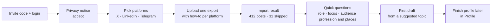
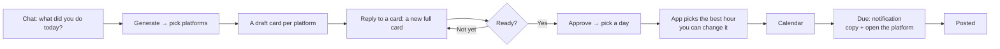
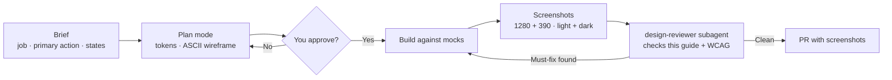

# Design Guide — Voxlace

How Voxlace should look, feel and behave, and how to design it with Claude Code. Read this before building any screen. Requirements still live in [`SRS.md`](SRS.md); this guide says how to present them.

> **The one idea behind every screen:** the user is the author, Voxlace is the drafter. Every screen should make it obvious what the AI wrote, why, and what will happen when the user clicks.

---

## Contents

1. [Design principles](#1-design-principles)
2. [Information architecture](#2-information-architecture)
3. [Core flows](#3-core-flows)
4. [Screen specs](#4-screen-specs)
5. [Visual direction](#5-visual-direction)
6. [Components](#6-components)
7. [States: loading, empty, error](#7-states-loading-empty-error)
8. [Writing in the interface](#8-writing-in-the-interface)
9. [Accessibility](#9-accessibility)
10. [Responsive and motion](#10-responsive-and-motion)
11. [Designing with Claude Code](#11-designing-with-claude-code)
12. [Design QA checklist](#12-design-qa-checklist)
13. [Sources](#13-sources)

---

## 1. Design principles

Grounded in Microsoft's 18 Guidelines for Human-AI Interaction (G1–G18) and research on editing text with LLMs.

| # | Principle | What it means on screen | Grounded in |
|---|---|---|---|
| 1 | **You're the author** | Nothing leaves the app without an explicit Approve or Publish click. The button says exactly what happens: "Copy and open Telegram", not "Submit". | G16 (convey consequences), FR-12, NFR-6 |
| 2 | **Just the draft** | The editor shows the draft and nothing about how it was made: no sources, no model names, no scores. The user judges the words and gives feedback. Pinning and excluding past posts (FR-25) lives in Voice. *(Changed 19 Oct 2026 at the product owner's request; replaces "Show your sources".)* The exact prompt (NFR-15) shows only in development builds (owner, 2 Nov 2026). | Calm by default; FR-11 still labels it "AI draft" |
| 3 | **Be honest about quality** | Show voice strength per platform from post count ("12 posts: voice is still learning"). Never promise a perfect match. | G1–G2 (what it can do, how well), FR-5 |
| 4 | **Fix in one click** | Quick revisions (Shorter, Punchier, More casual) sit next to a free-text "Tell it what to change" box. People use both. | G9 (efficient correction); toolbar + free-prompt study |
| 5 | **Preview the real thing** | Drafts render the way each platform shows them: X's limit and line breaks, LinkedIn's "see more" fold at about 210 characters. | Platform rules, FR-9 |
| 6 | **Never lose input** | A failed or slow generation keeps the topic, check-in and edits exactly where they were. | NFR-4 |
| 7 | **Remember, then adapt slowly** | Recent topics and check-ins stay one click away. Voice cards change only when the user regenerates or edits them. | G12–G14, FR-26 |
| 8 | **Calm by default** | One accent color, one place for boldness: the draft. The interface recedes so the user's words stand out. | Frontend aesthetics guidance |

---

## 2. Information architecture

**Decided by the product owner, 22 Oct 2026** (replaces the 21 Oct layout).

**Left sidebar** (flat and full height, on `--sidebar`), top to bottom:
- the wordmark and the **theme toggle** (sun/moon: light ⇄ dark);
- **Chat**: "New chat", then past threads, newest first (like ChatGPT's history);
- **Drafts**: opens to **X · LinkedIn · Telegram**, each a list of that platform's drafts;
- **Calendar**;
- at the bottom: the collapse button and **your avatar → Profile**.

**Notifications** (a post is due now, today's check-in reminder) and **Missed** (approved posts whose time passed without "Posted", each with Post now and Reschedule) open from a **bell** in the sidebar header, or the phone's top bar, at every width. *(Changed 21 Nov 2026: the right sidebar is gone, so the chat canvas keeps its room; the bell shows only when something needs you.)*

On mobile, Chat · Drafts · Calendar · Profile become a bottom tab bar.

| Place | Purpose | Requirements |
|---|---|---|
| **Chat board** (home, `/` and `/chat/:id`) | "What did you do today?" → Save or Generate → pick platforms → a draft card per platform in the thread → talk to it until it's right → Approve → pick a day → it's on the calendar | FR-6, FR-7, FR-8, FR-10, FR-40, FR-45, FR-46 |
| **Drafts** (`/drafts/:platform`) | One platform's drafts by status; each card has Reschedule, Discard and, once approved, Copy now; Edit opens its thread | FR-10, FR-11, FR-12 |
| **Calendar** | Month, week and day views; drag to reschedule; Edit opens the thread | FR-13, FR-16 |
| **Profile** (avatar) | Everything about you, all editable: about you, work and facts, resume and portfolio, audience per platform (profession and places), when you can post, voice and posts per platform, reminders, Telegram channel name, usage, export and delete | FR-1, FR-5, FR-17, FR-18, FR-20–FR-26, FR-30, FR-33, FR-38, FR-42 |

There's no separate editor page any more: a draft is edited in its thread. `/drafts/:id` opens the thread with that card in focus, so every draft keeps a shareable URL.

---

## 3. Core flows

### First run: from sign-up to first draft in under 5 minutes

Activation is a success metric (SRS §9), so onboarding asks only what the first draft needs. Everything else can wait. *(21 Nov 2026: the flow below is now "write first, optional questions after the draft"; see §4.5.)*



- Upload **one** export to start. The others can be added from Voice.
- The export how-to opens beside the upload box: steps, screenshots and "takes about a day" for LinkedIn.
- The first topic is suggested ("Write about what you're building this week") so the user doesn't face a blank box.

### Daily loop



---

## 4. Screen specs

Wireframes show layout and hierarchy, not final styling.

### 4.1 Chat board (home)

**Changed 21 Nov 2026 (product owner): a canvas, not an endless thread.** The new chat is one question and one box: Enter writes drafts for the platforms picked as chips inside the box (remembered), Shift+Enter is a new line, Options holds "Save as a check-in" and "Past check-ins", and "/" lists commands (`/x`, `/linkedin`, `/telegram`, `/all`, `/save`). Starters under the box follow the user's profession. A chat then shows the check-in, the history (older versions folded, the user's notes) and the message box on the left, and the **draft panel** on the right from 1280px (stacked under the check-in below that): one tab per draft, the newest version open, with one-click changes under the text (Shorter, Punchier, More casual, Add a hook, Translate, Another version, Undo), Preview and Edit as icon buttons, and one primary action (Approve, then the hand-off). "+" writes for a platform the chat doesn't have yet. The wireframe below is the earlier thread, kept for its card contents.

```
┌────────────┐                                                         ┌──────────────┐
│ Voxlace ☾  │   What did you do today?                                │ Notifications│
│ + New chat │   ┌──────────────────────────────────────────────────┐  │ X post due   │
│ Chat       │   │ Finished the Telegram importer, 412 posts in…    │  │  now · Open  │
│  Today's…  │   │                              [Save] [Generate]   │  │              │
│  Importer… │   └──────────────────────────────────────────────────┘  │ Missed       │
│ Drafts ▾   │                                                         │ LinkedIn ·   │
│  X         │   You  Finished the Telegram importer…                  │ Tue 09:00    │
│  LinkedIn  │   ┌ X draft · v1 ─────────────────────── AI draft ┐     │ [Post now]   │
│  Telegram  │   │ Small win today: the Telegram importer works…  │     │ [Reschedule] │
│ Calendar   │   │ 238 / 280   [Approve] [Copy] [Make a LinkedIn…]│     └──────────────┘
│            │   └────────────────────────────────────────────────┘
│ (F) Fete   │   ┌ Replying to: X draft ✕ ─ Tell it what to change… ─ [Send] ┐
└────────────┘   └────────────────────────────────────────────────────────────┘
```

- **Save** keeps the check-in. **Generate** asks "Which platforms?" in the thread (three toggles, remembering the last choice), then posts one card per platform.
- **Cards are the drafts.** A card shows the platform, version, the draft text, the length counter and "AI draft". Click a card to reply to it: the box shows **Replying to: X draft**. With one draft in the thread, replies go to it.
- **Every reply that changes the text is a new full card** (v2, v3…), like ChatGPT's answers. Older cards stay above, folded to their first line. A question from the assistant appears as a plain message.
- **Quick changes** (Shorter, Punchier, More casual, Add a hook) sit above the box when a card is selected. Selecting a sentence in a card scopes the next change to it.
- **Card actions:** Approve; Copy and open (approved cards only: nothing is handed off before Approve, CLAUDE.md rule 4), or, with the Telegram bot connected, **Post to Telegram now**: Approve opens one date-and-time field ("Approve for this time"; Change time uses the same field, no day chips or reasons), approving says "The bot posts it to <channel> at that time.", the approved card reads "Posts to <channel> Tue 18:00", and a send the bot couldn't make reads "The bot couldn't post it: <reason>" (FR-36, ADR 0001, 24 Nov 2026). Connect it in Profile → Connections → Telegram: Connect Telegram (opens the bot with a one-time link), then "Add @VoxlaceBot to your channel" (Telegram's channel picker with the rights filled in); the page updates by itself, and "Didn't work? Add the bot as an admin by hand" is always shown; ⋯ → Make an X / LinkedIn / Telegram version (a new card, FR-40), Edit by hand, Discard.
- **Approve** asks in place: "Which day?" (the next seven days as chips, plus a date). The app answers with the hour it picked and why: "Tue 18:00 · 70% of your audience (Addis Ababa) is off work · Telegram's evening peak" with **Change time**. Then the card shows "Approved · on your calendar".
- An empty thread shows starter ideas under the box.

### 4.2 Drafts

- The sidebar's Drafts opens to X · LinkedIn · Telegram; each opens `/drafts/:platform`.
- Status tabs: Drafts · Approved · Posted · Discarded.
- Each card: first lines, status, scheduled time. Icons along the bottom: **Reschedule** (pick a day; the hour is picked for you), **Copy now** on approved posts only (copies the text and opens X / LinkedIn / your Telegram channel, then asks "Did you post it?" → Posted; a draft shows Approve in its place); with the Telegram bot connected and allowed to post, a Telegram draft shows **Post to Telegram now** instead, here, in the chat, on the calendar and in the bell: the bot sends it and it's Posted, nothing to ask (FR-36, 24 Nov 2026), **Discard** (moves it to Discarded with Undo; the same verb as the chat's ⋯ menu, §8; Discarded has Restore and "Delete forever"). **Edit** opens the thread.

### 4.3 Calendar

- **Month:** rows are weeks, columns are days; each post is a chip with its time.
- **Week:** columns are days, rows are hours. **Day:** one column, rows are hours. Both scroll to 07:00 and lightly shade the best hours of the selected platform.
- Drag a post to another day (month) or slot (week, day); works with touch. Every item also has **Move to…** with a day and time picker (WCAG 2.5.7).
- Posts at the same time sit side by side. Missed posts are red with Post now.
- **Edit** opens the draft's thread; **Posted** marks it published.
- Times are in the user's zone; the views load only their visible range.

### 4.4 Profile

**Changed 21 Nov 2026: five tabs, optional things folded.** About you (the basics open: profession, what you're working on, what you're getting better at; the other groups, projects, language and resume fold away and say how many answers are filled) · Audience & timing (with check-in reminders) · Voice & posts · **Connections** (free AI key, Telegram channel, GitHub, which is open only for developers) · Account. Old tab links (`?tab=ai`, `github`, `resume`, `when`) open the new tab at the right section. The list below is the earlier tab set, kept for what each holds.

Tabs: **About you** (role, experience, discipline, your time zone, language), **Work** (projects with name, one line and link; stack; focus areas; facts the AI may use), **Resume & portfolio** (upload a PDF/DOCX, enter a URL, review the cleaned text before it's used), **Audience** (per platform: profession, places with shares on a time-zone search, goal, posts per week, and a preview of the best hours), **When you post** (posting window, days off, reminders), **Voice & posts** (per platform: voice card, stats, pin/exclude, import, Telegram channel name), **Account** (usage, export, delete).

### 4.5 First run

**Changed 21 Nov 2026 (product owner): one question, then a draft.** After sign-up (and the invite and privacy steps), a new account lands on "What did you do today?" with "One line is enough. You'll get a draft to edit in seconds." Editing beats a blank page, so nothing is asked first. Under the first drafts, an optional card asks two one-tap questions (what you do, why you post) and offers "Import your past posts"; "Not now" hides it for a week, and accounts that already have a role never see it. The old four-step setup still opens at `/welcome` but nothing sends anyone there. Everything else waits in Profile.

---

## 5. Visual direction

**Decided 20 Nov 2026 (v4), by the product owner:** a ChatGPT-style chat look, light and dark only. This replaces v3 (ScholarXIV's zinc palette, Archivo and the serif, 22 Oct 2026). We take ChatGPT's layout and feel, never its name, logo or icons. The tokens live in `frontend/src/index.css`.

**Concept: "a calm chat."**
- Neutral greys; color only carries meaning.
- A flat, full-height sidebar in a slightly different grey from the page; no floating card.
- What the user typed sits in a soft right-aligned bubble; the drafts answer below it.
- One rounded pill composer with a round send button.
- Buttons are pills. The primary button is near-black and flips to white in dark.
- Teal stays as a small mark for the AI only: the "AI draft" label, links and the focus ring.

### Themes

| Theme | What it is | When |
|---|---|---|
| Light | White page, `#F9F9F9` sidebar, near-black primary | Default when the system is light |
| Dark | Near-black `#0A0A0A` page, pure black `#000000` sidebar (changed 20 Nov 2026: `#212121` read as grey); primary flips to white | Default when the system is dark |

- The toggle (sun/moon) sits in the sidebar header and switches light ⇄ dark.
- The choice is saved per browser; the system preference is the first default.
- In code it's `<html data-theme="light|dark">`.

### Color tokens

| Token | Light | Dark | Use |
|---|---|---|---|
| `--paper` | `#FFFFFF` | `#0A0A0A` | App background |
| `--surface` | `#FFFFFF` | `#0A0A0A` | Cards and panels (with a `--line` border) |
| `--sidebar` | `#F9F9F9` | `#000000` | Sidebar and mobile tab bar |
| `--bubble` | `#F4F4F4` | `#1F1F1F` | The user's message bubble |
| `--composer` | `#FFFFFF` | `#171717` | The message box |
| `--sunken` | `#ECECEC` | `#1C1C1C` | Hover and current nav item, chips, status badges |
| `--line` | `#E5E5E5` | `#262626` | Dividers and card borders (decorative) |
| `--edge` | `#8F8F8F` | `#8E8E8E` | Outlines of inputs and buttons (≥ 3:1) |
| `--ink` | `#0D0D0D` | `#ECECEC` | Main text |
| `--ink-2` | `#5D5D5D` | `#A3A3A3` | Secondary text, meta lines, placeholders |
| `--primary` | `#0D0D0D` | `#FFFFFF` | **Primary buttons**, the send button, selected chips |
| `--on-primary` | `#FFFFFF` | `#0D0D0D` | Text on primary buttons |
| `--thread` | `#2B6B5B` | `#72C4AE` | The AI mark only: "AI draft" label, focus ring, links |
| `--signal` | `#8F5508` | `#E3A64C` | Near the limit, "still learning", due now |
| `--danger` | `#B42318` | `#F2806F` | Over the limit, errors, missed, delete |

**Contrast, all measured (WCAG 2.2 AA: 4.5:1 for text, 3:1 for UI parts):**

| Pair | Light | Dark |
|---|---|---|
| `--ink` on `--paper` / `--sidebar` / `--bubble` / `--sunken` | 19.4 / 18.5 / 17.7 / 16.5 | 16.8 / 17.8 / 14.0 / 14.4 |
| `--ink-2` on `--paper` / `--sidebar` / `--bubble` / `--sunken` | 6.6 / 6.3 / 6.0 / 5.6 | 7.8 / 8.3 / 6.5 / 6.8 |
| `--thread` on `--paper` / `--sunken` | 6.3 / 5.3 | 9.6 / 8.3 |
| `--signal` on `--paper` / `--sunken` | 6.1 / 5.1 | 9.3 / 8.0 |
| `--danger` on `--paper` / `--bubble` | 6.6 / 6.0 | 7.6 / 6.4 |
| `--on-primary` on `--primary` (primary button) | 19.4 | 19.4 |
| `--edge` on `--paper` / `--composer` (input outlines) | 3.2 / 3.2 | 6.0 / 5.5 |

### Type

| Role | Typeface | Fallback for Amharic (FR-24) | Notes |
|---|---|---|---|
| Everything: interface and the user's writing | **Inter** 400/600 (chosen 20 Nov 2026) | **Noto Sans Ethiopic** | One family, like ChatGPT. Sentence case. |
| Code, keys, repo names | **JetBrains Mono** 400 | — | `font-mono`, and every `code` / `pre` / `kbd` by default |
| Platform previews | The platform's own system stack (+ Noto Sans Ethiopic) | same | So the preview looks like the real post |
| Numbers in counters | Inter with `tabular-nums` | — | Digits don't jump while typing |

Inter has no Ethiopic letters, so the browser takes each Amharic character from Noto Sans Ethiopic, named right after it. All three fonts are OFL-licensed and **self-hosted** through `@fontsource` packages, so user pages make no third-party font requests.

| Token | Size | Use |
|---|---|---|
| `--text-xs` | 13px | Meta lines, badges, hints, sidebar section titles |
| `--text-sm` | 14px | Buttons, navigation, labels |
| `--text-md` | 16px | Interface body **and the user's writing** (messages, drafts, check-ins), line-height 1.65 |
| `--text-lg` | 18px | Sidebar wordmark |
| `--text-xl` | 22px | Chat titles, panel titles |
| `--text-2xl` | 30px | Page questions ("What did you do today?") |

Headings 22px and up use `--tracking-tight` (−0.02em). Interface line-height is 1.5; writing line-height is 1.65 (`leading-writing`). **Weights: 400 and 600 only.**

### Logo

**Chosen 20 Nov 2026: black and white.** The "talking o" wordmark (`voxlace` in Outfit Bold, outlined, the o drawn as a speech bubble) and the bubble-o mark, both in **one colour**: ink in light mode and paper in dark mode (`currentColor`, via `components/Logo.tsx`). The teal-o version stays in `design/brand/` for later, but isn't used.

| Where | What |
|---|---|
| Sidebar, phone header, login, guest and status pages | `<Wordmark />` (20–28px high); the collapsed sidebar shows `<LogoMark />` |
| Browser tab | `public/favicon.svg`: white bubble-o on an ink rounded square |
| iPhone home screen | `public/apple-touch-icon.png`, 180px, full square |
| Link previews (X, LinkedIn, Telegram) | `public/og-image.png`, 1200×630: paper wordmark on ink |
| GitHub app logo | `design/brand/assets/voxlace-logo-ink-512.png` |

Rules: never set "voxlace" in a font; use the component. Keep space around it equal to one o. Don't recolour part of it.

### Space and shape

- 4px grid: `--space-1` to `--space-12` = 4, 8, 12, 16, 24, 32, 48.
- Radius: `--radius-control` 10px (inputs, nav items), `--radius-panel` 16px (cards, panels), `--radius-composer` 28px (the message box), `rounded-3xl` for the user's bubble, **pills for every button**, chips and badges.
- **Borders separate, shadows float.** Cards and panels get a 1px `--line` border. The composer gets the faint `--shadow-composer`; menus, dialogs and toasts use `--shadow-float`. Focused inputs and buttons get a 2px `--thread` ring.
- **Bars never hide focus** (WCAG 2.4.11): pages with a sticky composer or action bar set `scroll-padding-bottom` to the bars' height.
- Layout: a flat sidebar 260px on `--sidebar`, full height, no border → 64px icon rail when collapsed → bottom tab bar below 768px. A **right panel** of 300px for notifications and missed posts from 1280px up; below that it's a bell. One centered column, `--column` 720px. The new-chat question and its composer sit centered, about a fifth of the way down.

### Motion

- `--duration` 150ms for hover and color, `--duration-reveal` 200ms for something appearing (a panel, a draft's text), both with `--ease` `cubic-bezier(0.2, 0, 0, 1)`. Transform and opacity only.
- The one signature moment is the draft text arriving (§10): it fades up once (`.animate-reveal`).
- `prefers-reduced-motion` sets every duration to 0.
- **Touch:** every control is at least 44px on a touch screen (a global rule in `index.css`); 40px with a mouse.

---

## 6. Components

**Recommendation: [shadcn/ui](https://ui.shadcn.com/docs).** It copies accessible component source into your repo (built on headless primitives and Tailwind), so you own and restyle the code instead of fighting a library's look. **Agreed by the product owner, 2 Nov 2026:** used for menus, dialogs and tabs, restyled with the tokens in §5.

**Recipes (21 Nov 2026), `frontend/src/lib/ui.ts`:** `primary` (the one main action), `secondary` (outlined pill), `ghost` (text only), `iconButton` (needs `aria-label` + `Tooltip`), `chip` / `chipOn`, `field`, `panel`. Screens use these instead of writing their own button classes. Tooltips and shortcut hints use `components/ui/tooltip.tsx` (`Tooltip`, `Kbd`), never the browser's `title`. The same system in the ui-ux-pro-max layout: `design-system/voxlace/MASTER.md`.

Product components to build on top:

| Component | Job | Must have |
|---|---|---|
| `DraftEditor` | Edit the text | Serif text, selection-scoped revise, autosave indicator |
| `PlatformPreview` | Show the real look | X, LinkedIn (with "see more" fold), Telegram variants |
| `LengthCounter` | Count by platform rule | Uses the shared counting rules and fixture (OPEN_QUESTIONS Q14); amber/red states with text, not color alone |
| `QuickActions` | One-click revisions | Labelled buttons, keyboard reachable, disabled while generating |
| `ReviseBox` | Free-text instruction | Placeholder examples, Enter to send, Shift+Enter for a new line |
| `VersionMenu` | History and restore | Instruction per version, diff view |
| `StatusBadge` | Draft status | Text label + icon, never color alone |
| `AiLabel` | A small "AI draft" tag (FR-11) | Always visible under the draft; never a banner |
| `ActionBar` | Approve / Publish / Open in X | Button text states the consequence |
| `CalendarItem` | A planned post | Drag + "Move to…" menu, status, platform |
| `EmptyState` | First-use guidance | One sentence + one action |
| `Toast` | Confirm results | Same verb as the action ("Published to Telegram") |

---

## 7. States: loading, empty, error

| Situation | What the user sees |
|---|---|
| Generating | A placeholder in the draft card's frame appears at once and names the step ("Reading your check-in", "Finding examples in your posts", "Writing your X draft", "Checking the length and the facts"), with **Stop**. The API returns the whole draft, so the text then arrives with a short word-by-word reveal (off under reduced motion). Screen readers hear each step once and "Draft ready" when done (`aria-live="polite"`). Stop cancels the wait; if the server finishes anyway, the draft appears. |
| Slow response | After 3 seconds the placeholder adds "Still working…"; after 20 seconds (NFR-3) offer **Cancel** and **Try again**. Never a blank screen. |
| Rate-limited (429) | "The AI is busy right now. Your text is saved. Try again in a minute." with **Try again**. |
| AI unavailable (503) | "Drafts are unavailable right now. Your check-in is saved." with Try again, the free-key offer, and **Copy your check-in** so the user can still post by hand today. |
| Daily limit reached | The limit line in quiet grey (it isn't an error), then "You've used today's free drafts. Add a free key to keep going, or come back tomorrow." with **Add a free key** and **Maybe later** (equal weight). Saving a key writes the failed drafts at once. In a first session, or after Maybe later, one line instead: "Come back tomorrow, or add a free key to keep going today." No "Try again" (it would only fail again). |
| Under 20 posts | Voice strength badge: "Still learning: import more posts for a closer match." (FR-5) |
| Empty chat | Starters by profession under the box. A chat with no drafts: "Your drafts appear here" + platform chips + **Write drafts**. |
| Empty Drafts | "Your drafts will appear here. Start a chat." with a button. |
| Empty Calendar | "Approve a draft and pick a time to see it here." |
| Import failed | Names the problem and the fix: "This isn't a Telegram export. Export your channel as JSON from Telegram Desktop." |
| Missed post | Calendar item and the Missed list turn `--danger`: "Tue 09:00 passed. Post now or reschedule." |

---

## 8. Writing in the interface

- **One verb per action, everywhere.** Generate → Revise → Approve → Schedule → Publish. The toast repeats the verb: Publish → "Published".
- **Sentence case** for everything. No all-caps labels.
- **Say what happens.** "Copy and open Telegram", "Open in X", "Copy text and open LinkedIn".
- **Errors say what happened and what to do.** No "Oops", no apologies, never "Something went wrong" alone.
- **Talk about the user's world**, not the system: "your posts", "your voice", not "embeddings", "vectors" or "RAG".
- **Times always with a zone hint** when it's ambiguous: "18:00 your time (10:00 New York)".

---

## 9. Accessibility

Target **WCAG 2.2 AA**. The 2.2 additions matter here:

| Criterion | Where it bites in Voxlace |
|---|---|
| 2.5.7 Dragging movements (AA) | Calendar drag must have a click alternative ("Move to…") |
| 2.5.8 Target size, minimum 24×24px (AA) | Quick-action chips, calendar items, icon buttons |
| 2.4.11 Focus not obscured (AA) | The sticky action bar and the bottom composer must not cover the focused element |
| 3.3.8 Accessible authentication (AA) | Login allows password managers and paste; no puzzles |
| 3.3.7 Redundant entry (A) | Don't ask for audience or time zone twice across onboarding and settings |

Also:
- Visible focus ring in `--thread` on every interactive element.
- Status is never color alone: add text or an icon (counter, badges, calendar).
- Respect `prefers-reduced-motion` and `prefers-color-scheme`.
- Keyboard: `⌘/Ctrl+Enter` sends the composer or revise box, `Esc` closes panels. Avoid single-letter shortcuts (WCAG 2.1.4); show shortcuts in tooltips.
- Every form field has a visible label; errors are linked to their field.

---

## 10. Responsive and motion

- **Desktop-first** for writing and planning (1280px). **Mobile must handle the quick jobs:** check a due post, approve, publish, copy. Test at 390px.
- Breakpoints: below 768px the sidebar becomes a bottom bar and the editor becomes one column with an Edit / Preview switch.
- **Motion only in response to the user,** and one signature moment: the draft text streaming in. No fade-ins on every section, no hover animation on every card.

---

## 11. Designing with Claude Code

Use **Opus** for design work (`/model opus` in Claude Code): it's the strongest at planning, critique and following a long spec. These steps follow Claude Code's own best practices: plan before you code, and give Claude a check it can run, such as a screenshot compared against the plan.

### The loop for each screen



1. **Run `/design-screen <screen>`** (in `.claude/skills/`). It reads this guide and the screen's requirements, writes a brief and an ASCII wireframe, and **stops for your approval**.
2. **Build against mocks** that match `docs/API.md` (`VITE_USE_MOCKS=true`), so design isn't blocked on the backend.
3. **Screenshot and compare.** Claude takes screenshots with Playwright at desktop and mobile widths, in light and dark, and reads them back. A picture of the result is the verification step.
4. **Second opinion.** The `design-reviewer` subagent (`.claude/agents/`) reviews the screenshots against this guide in a fresh context, so the agent that built it isn't grading itself.
5. **PR with before/after screenshots.** The teammate reviews the pictures first, then the code.

### Prompting tips that work

- **Paste a screenshot** of a reference (your sketch, a Figma frame, a competitor screen) and say "match this layout, use our tokens".
- **Name what to avoid** as well as what you want: "no card grid, no gradient, no all-caps labels".
- **Give it real content** from `samples/` instead of lorem ipsum, so line lengths and edge cases are real.
- **One screen per session.** Run `/clear` between screens to keep context lean.
- **Two failed corrections? Start fresh** with a better brief instead of correcting a third time.

### Optional tools (add only if needed)

- Anthropic's `frontend-design` plugin, via `/plugin`, adds general aesthetic guidance. This guide already covers it for Voxlace.
- A Figma MCP server, only if you design in Figma first.

---

## 12. Design QA checklist

Run before every UI pull request (the `design-reviewer` agent uses this list):

- [ ] The primary action is obvious, and its label says what happens
- [ ] Nothing publishes without approval; buttons say what happens (no icon-only primary actions)
- [ ] Nothing about sources, models or scores on drafts; the "AI draft" tag is under the draft in the editor (FR-11)
- [ ] Loading, empty, error and over-limit states designed, not just the happy path
- [ ] Only tokens from §5; no hard-coded colors or one-off font sizes
- [ ] Inter for all text, JetBrains Mono for code; sentence case
- [ ] Contrast passes (4.5:1 text, 3:1 UI); status not shown by color alone
- [ ] Keyboard: every action reachable, focus visible and not covered
- [ ] Targets at least 24×24px; drag has a click alternative
- [ ] Works at 390px and 1280px, light and dark
- [ ] Reduced motion respected
- [ ] Copy follows §8: one verb per action, specific errors, no jargon

---

## 13. Sources

- [Microsoft HAX Toolkit: Guidelines for Human-AI Interaction](https://www.microsoft.com/en-us/haxtoolkit/library/)
- [Nielsen Norman Group: Adding UI Controls to Prompting](https://www.nngroup.com/articles/prompt-controls-genai/)
- [Functional Flexibility in Generative AI Interfaces: text editing with LLMs through conversations, toolbars and prompts (arXiv 2410.10644)](https://arxiv.org/pdf/2410.10644)
- [W3C: What's new in WCAG 2.2](https://www.w3.org/WAI/standards-guidelines/wcag/new-in-22/)
- [Claude: Improving frontend design through Skills](https://claude.com/resources/articles/improving-frontend-design-through-skills)
- [Claude Code: Best practices](https://code.claude.com/docs/en/best-practices)
- [shadcn/ui documentation](https://ui.shadcn.com/docs)
