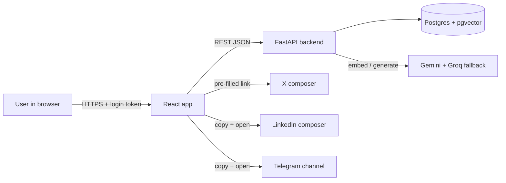
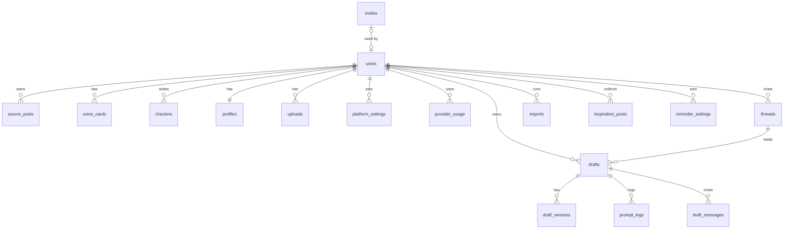

# Software Requirements Specification — Voxlace V1

| | |
|---|---|
| **Product** | Voxlace (working name) |
| **Version** | 1.3 — Telegram as a hand-off, chat board, posting times |
| **Date** | 22 October 2026 |
| **Authors** | Fetehadin Negash, Nezira |
| **Status** | Locked. Changes go through a pull request that edits this file. |

---

## Contents

1. [Introduction](#1-introduction)
2. [Overall description](#2-overall-description)
3. [Functional requirements](#3-functional-requirements)
4. [Non-functional requirements](#4-non-functional-requirements)
5. [External interfaces](#5-external-interfaces)
6. [Data model](#6-data-model)
7. [Platform rules](#7-platform-rules)
8. [Out of scope for V1](#8-out-of-scope-for-v1)
9. [Success metrics](#9-success-metrics)
10. [Traceability to the build plan](#10-traceability-to-the-build-plan)
11. [Change log](#11-change-log)

---

## 1. Introduction

### 1.1 Purpose

This document defines what Voxlace V1 must do and how well it must do it. Every requirement has a yes/no test. The two developers use it to decide what to build, and to check when something is done.

### 1.2 Product scope

Voxlace is a web app that learns a person's writing voice from their own exported posts, daily check-ins and profile. It drafts separate posts for **X**, **LinkedIn** and **Telegram**, following each platform's rules. The user polishes every draft in a chat, approves it, picks a day (the app picks the best hour for their audience) and publishes it with one click.

V1 must prove one thing: **people actually publish the drafts it writes, with light edits.**

### 1.3 Definitions

| Term | Meaning |
|---|---|
| **Source post** | A post the user wrote in the past, imported from a platform export. |
| **Embedding** | A list of 768 numbers that represents the meaning of a text. Similar texts have close embeddings. |
| **RAG** | Retrieval-augmented generation. At draft time the app finds the user's most similar past posts and puts them in the prompt as examples. No model is trained. |
| **Voice card** | A short written summary of how the user writes on one platform, plus measured stats (length, emoji, hashtags). |
| **Summary card** | A ~150-word summary of the user's profile form and uploads, used in every prompt. |
| **Check-in** | A daily note the user writes on the chat board about what they did or think. |
| **Hand-off** | Moving an approved draft to its platform: pre-filled link (X), copy + open composer (LinkedIn), copy + open the user's channel (Telegram). Voxlace never posts by itself in V1. |
| **Thread** | One chat on the chat board: a check-in, the drafts made from it and every revision, in order (like a ChatGPT conversation). |
| **Best hours** | For one platform and day, the user's hours ranked by how active their audience is then: audience places and profession, study-based curves, and later the user's own results. |
| **Platform profile** | The rules for one platform: length limit, counting rule, tone and structure notes. Stored in the database. |
| **Fallback chain** | The ordered list of AI models the app tries when one is unavailable. |

### 1.4 References

- Pre-Build Plan (Claude Docs) — decisions, gotchas and sources behind this SRS.
- [`BUILD_PLAN.md`](BUILD_PLAN.md) — phases, task split and cycles.
- [`API.md`](API.md) — the first API contract.
- [pgvector README](https://github.com/pgvector/pgvector) · [Gemini API embeddings](https://ai.google.dev/gemini-api/docs/embeddings) · [Gemini API rate limits](https://ai.google.dev/gemini-api/docs/rate-limits) · [Telegram Bot API](https://core.telegram.org/bots/api)

---

## 2. Overall description

### 2.1 Product perspective

A new, standalone, multi-user web app (SaaS from day one, without billing). It depends on:

- **Google Gemini API** for embeddings and generation, with one extra free provider as a generation fallback.
- **A managed login provider** (Supabase Auth, used for login only; data stays in our own Postgres).
- **One Contabo VPS** the team already owns, running everything in Docker.
- **PostgreSQL + pgvector** for all data, including embeddings.
- **Static export files** the user uploads. No live reads from X or LinkedIn.

### 2.2 User classes

| User | Description | V1 support |
|---|---|---|
| **Builder** (primary) | A developer who ships work and wants to post about it regularly on X, LinkedIn and Telegram in their own voice. | Full |
| **Invited tester** | A builder invited by the team to try the app with their own data. | Full, invite-only |
| **Admin** | The two developers. Manage invites and platform profiles. | Via the `app.dev` commands and migrations; no admin UI |
| Other roles (designers, photographers…) | Need different profile fields. | Later |

### 2.3 Operating environment

- Modern desktop browsers (Chrome, Firefox, Safari, Edge — latest two versions). Mobile layout should work but is not tuned.
- Backend: Python 3.12+, FastAPI. Frontend: React + Vite + TypeScript on Node LTS.
- Database: PostgreSQL with pgvector (`pgvector/pgvector:pg18` image, locally and on the server).
- Hosting: one Contabo VPS running Docker Compose: Caddy (static frontend, behind the server's shared HTTPS Caddy), API, Postgres. Always on.

### 2.4 Constraints

| # | Constraint |
|---|---|
| C-1 | **No new cost.** The Contabo server the team already pays for, free-tier AI, no paid platform APIs. |
| C-2 | **No model training.** Quality comes from retrieval and prompts only. |
| C-3 | **No platform passwords, no scraping.** Only the user's own exports and official bot tokens. |
| C-4 | **X API costs money** ($0.015 per post, $0.20 with a URL), so X is hand-off only. |
| C-5 | **LinkedIn cannot be pre-filled**, so it is copy + open composer. |
| C-6 | **No Telegram bot in V1** (decided 22 Oct 2026). Telegram is a hand-off like LinkedIn: copy the text and open the user's channel. Bot publishing (FR-36, FR-43) waits until after V1. |
| C-7 | **The embedding model is fixed.** Vectors from different models cannot be compared, so there is no embedding fallback. |
| C-8 | **Free AI quota is shared** by every user of the project and resets at midnight Pacific time. |
| C-9 | **Free-tier Gemini data may be used to improve Google's products.** Users must be told before uploading. |

### 2.5 Assumptions and dependencies

- Users can request and download their own exports (LinkedIn takes 1–2 days to deliver).
- Users have at least ~20 past posts per platform for good style matching; below that the app warns and uses a shared example pool.
- Users click to publish on every platform, so a suggested time must fall inside the hours they can post.
- The Contabo server stays up; Docker restarts crashed containers (`restart: unless-stopped`).

---

## 3. Functional requirements

**Priority:** **Must** = V1 core, required before inviting testers. **Should** = V1 stretch, added once the core works.

### 3.1 Import and embeddings

| ID | Requirement | Priority | Test |
|---|---|---|---|
| FR-1 | The user can upload an X archive, a LinkedIn archive and a Telegram export. The app reports how many posts it parsed from each. | Must | Import a sample of each; counts match the file. |
| FR-2 | Import skips replies, reposts and empty posts. Re-importing the same file creates no duplicates. | Must | Import twice; row count is unchanged. |
| FR-3 | A malformed file is rejected with a readable error, and nothing is half-saved. | Must | Upload a broken file; no rows are added. |
| FR-4 | Every imported post is embedded and stored with its user, platform and original date. | Must | After import, no post lacks an embedding. |
| FR-39 | The importer reads only the posts file from each export and discards everything else. | Must | Upload a full X archive; only posts are stored. |
| FR-44 | Import skips posts carrying any hashtag on the user's editable excluded list (default: religious, personal-life and shared-content tags), and embeds the best ~1,000 posts first, ranked by reactions and recency; the rest stay queued. | Must | Import a channel with #Family posts; none are stored. Import 2,000 posts; drafting works after the first 1,000 are embedded. |
| FR-32 | If the embedding service is unavailable, imports are queued and retried. The app never switches embedding models by itself. | Must | Block the embedding call; the import resumes later with no mixed vectors. |

### 3.2 Voice, profile and settings

| ID | Requirement | Priority | Test |
|---|---|---|---|
| FR-5 | The app builds a voice card and style stats per user and platform, and warns when a platform has fewer than 20 posts. | Must | Import 10 posts; the warning appears. |
| FR-17 | A new user fills in an "About you" form: role, experience level, discipline, stack, current projects (each with a name, one line and a link), focus areas, posting goal, topics, facts the AI may use, avoid list, voice words, emoji and hashtag habits, links and portfolio. Every field stays editable on the Profile page. | Must | Fill, reload, edit one field; values persist. |
| FR-18 | The app summarises the form and any uploads into a ~150-word summary card, shows it, and lets the user edit it before it is used. | Must | Edit the card; the next prompt log contains the edited version. |
| FR-22 | Profile has a section per platform showing the platform rules, the user's voice card with its stats, and pinned example posts. | Must | Open each tab; all three parts show. |
| FR-23 | Platform rules (limit, counting rule, tone and structure notes) live in the database, not in code. In V1 the team changes them with a migration; there is no edit screen (decided 22 Oct 2026). | Must | Change the X tone note in a migration; the next prompt log shows it. |
| FR-24 | Each user sets a language (or "same as my posts"), and prompts, voice cards and drafts use it. | Must | Set another language; the draft comes back in it. |
| FR-25 | The user can pin posts as examples and exclude posts from being used as examples. | Must | Exclude a post; it never appears in retrieval. Pin one; it always does. |
| FR-26 | The user can edit a voice card by hand, and regenerating it keeps those hand edits. | Must | Edit a line, regenerate; the line survives. |
| FR-33 | Onboarding asks, per platform, the audience's profession and where it lives (up to three places, each a time zone with a share), plus the user's discipline and the hours they can post. All of it stays editable on the Profile page. | Must | Finish onboarding; the answers appear in Profile; change a place there and the best hours change. |
| FR-20 | The user can upload a resume (PDF or DOCX) and enter a portfolio or website address, and the app extracts the text. | Must | Upload a sample resume; the extracted text appears. |
| FR-21 | Before any extracted text goes to the AI, phone numbers, email addresses and street addresses are removed, and the user reviews the cleaned text. | Must | Upload a resume with a phone and email; neither appears in the prompt log. |

### 3.3 Drafting

| ID | Requirement | Priority | Test |
|---|---|---|---|
| FR-6 | The user can save a daily check-in with a date, then view, edit and delete it. | Must | Create, edit and delete one. |
| FR-7 | Generating a draft needs a platform and a topic or a check-in. It retrieves only that user's posts for that platform. | Must | Generate for user A; no post from user B appears in the prompt log. |
| FR-8 | X, LinkedIn and Telegram each have their own generate action. | Must | Generate for one platform; the other two are untouched. |
| FR-9 | Each draft shows a live length count using that platform's rule, and blocks copy or publish when over the limit. | Must | Paste a 300-character draft for X; it is flagged. |
| FR-10 | An edit instruction revises the current draft, and earlier versions stay available. The user can also edit the text by hand. | Must | Ask "shorter"; a new version exists and the old one is viewable. |
| FR-40 | Drafts are polished in a chat, ChatGPT-style. The assistant knows the user's voice card, profile, platform rules and the day's check-in. Every reply that changes the text appears as a **new full draft** in the thread (and is a new version). It can revise only a selected sentence, write the same post for another platform (a new draft, the original untouched), and asks a question instead of inventing a missing fact. | Must | Ask "mention my other project" with two projects in the profile; it asks which one. Select one sentence and ask "fix this"; only that sentence changes. |
| FR-41 | The app detects the type of post being drafted (launch, progress, lesson, opinion, humor, tip, event) and adds structure examples from the user's inspiration posts **on the same platform** that are strongest at that type: Telegram drafts learn only from Telegram channels the user admires, X drafts only from X accounts, LinkedIn drafts only from LinkedIn creators. Platforms are never mixed. They shape structure only; voice comes from the user's own posts and facts from FR-19. The editor names the creator it used, and the user can change or turn it off. | Should | Draft a launch for X; the editor shows a launch-strong X creator, never a Telegram channel. No 5-word phrase from any inspiration post appears in the draft. |
| FR-46 | The chat board keeps one thread per conversation: the check-in, the drafts made from it and every revision. Past threads are listed in the sidebar, newest first, and reopen where they stopped. | Must | Generate for two platforms, revise one, reload; the thread shows all three cards in order. |
| FR-11 | Every draft is labelled AI-generated and has a status the user sets: draft, approved, published, discarded. | Must | Change the status; it persists after reload. |
| FR-19 | A draft may state facts only from the summary card, the day's check-in, or GitHub items the user approved. | Must | Request a draft with an empty check-in; it invents no metrics or projects. |
| FR-31 | Draft generation tries an ordered list of models from configuration, moves to the next when one is unavailable, rate-limited or removed, and records which model wrote each draft. | Must | Disable the first model; the draft arrives and names the second. |
| FR-14 | GitHub context lists today's commits and pull request titles, and the user can exclude items before they enter the prompt. | Should | Exclude one commit; it is absent from the prompt log. |

### 3.4 Calendar, scheduling and publishing

| ID | Requirement | Priority | Test |
|---|---|---|---|
| FR-12 | An approved draft is handed off when the user posts it. **X:** opens the composer pre-filled. **LinkedIn:** copies the text and opens the composer. **Telegram:** copies the text and opens the user's channel (`t.me/<channel>`; the channel name is set in Profile). Then "Posted" marks it published. | Must | Hand off one draft per platform; each behaves as described and the text arrives intact. |
| FR-13 | The user can place a draft on a calendar date and time and move it, and the app marks it due when the time arrives. | Must | Drag a draft to another day; it saves. |
| FR-35 | A due post shows a reminder in the app's notification panel. A post still not "Posted" 30 minutes after its time moves to a **Missed** list with "Post now" and "Reschedule". | Must | Schedule an approved draft for the next minute; within 2 minutes it shows as due, and 30 minutes after its time it shows under Missed. |
| FR-42 | The user sets daily check-in reminders (days and a local time). From that time the app shows the reminder in its notification panel, and stops for the day once there is a check-in. | Must | Set a reminder for the next minute; it shows within 2 minutes, and disappears after a check-in. |
| FR-43 | Replying to a reminder in the Telegram bot saves the reply as that day's check-in and offers a draft back in the same chat. | Later (after V1) | Reply to the bot; the check-in appears on the chat board. |
| FR-36 | A user connects a Telegram channel by adding the app's bot as an admin and entering the channel. The app confirms it can post before saving. | Later (after V1) | Connect a channel without admin rights; it is refused with a message. |
| FR-16 | The app ranks each day's hours per platform by audience activity: the audience's places (time zones with shares) and profession, a study-based curve per platform, and only hours the user can post. Times are shown in the user's own zone with a one-line reason. | Must | Change the audience place on Profile; the best hours shift. |
| FR-45 | Approving a draft asks only for the **day**. The app picks the hour: the first post on that platform that day gets the best hour, the second the next best that keeps a minimum gap, and so on. The user can change the time. | Must | Approve two X drafts for the same day; they get the best and second-best hours, at least 2 hours apart. |
| FR-34 | Posting-time suggestions start from study-based defaults and blend in the user's own archive data once they have at least 50 posts with engagement numbers on that platform. | Must | Import 60 posts with likes; the suggestion cites the user's own data. |

### 3.5 Accounts, limits and privacy

| ID | Requirement | Priority | Test |
|---|---|---|---|
| FR-27 | Users sign up and log in through a managed login provider, and every API call is tied to the logged-in user. | Must | Call the API logged out; it returns 401. |
| FR-28 | Sign-up is invite-only: it needs an invite code or an allow-listed email. | Must | Sign up without a code; it is refused. |
| FR-29 | A user can never read another user's posts, drafts, profile or uploads, through the app or the API. | Must | As user B, request user A's draft; 403 or 404. |
| FR-30 | Each user has daily limits on drafts and embeddings, shown in the app. | Must | Pass the limit; a clear message, other users unaffected. |
| FR-37 | Before any upload, a new user sees a short privacy notice and must accept it. | Must | Skip the notice; uploads are blocked. |
| FR-38 | A user can export and delete all their data. | Must | Delete; every post, draft, profile and upload row is gone. |
| FR-15 | The app records, for each draft, whether it was published and how much it was edited, and shows a weekly publish rate. | Should (recording is Must) | Publish two of four drafts; the page shows 50%. |

---

## 4. Non-functional requirements

| ID | Category | Requirement | Test |
|---|---|---|---|
| NFR-1 | Cost | V1 adds no cost beyond the existing Contabo server: free-tier AI, no paid APIs. | Billing pages show $0 after a week of use. |
| NFR-2 | Setup | One command starts the database on a fresh machine; the README documents the rest. | A new clone runs with `docker compose up` plus the README steps. |
| NFR-3 | Performance | A draft returns within 20 seconds in normal conditions. | Time ten drafts. |
| NFR-4 | Resilience | When the AI service rate-limits (HTTP 429), the user sees a clear message and loses no input. | Simulate a 429; the text box keeps its content. |
| NFR-5 | Security | Secrets live in `.env`, are never committed, and `.env.example` documents them. | A repository search finds no keys. |
| NFR-6 | Safety | The app never asks for a social platform password and never publishes without the user's explicit approval. | Code review: no password field; every send traces to an approval. |
| NFR-7 | Privacy | Each user's posts and edits are used only for that user's drafts. | The FR-7 test passes for both users. |
| NFR-8 | Quality | Parsers have automated tests using anonymised sample exports, run in CI. | The suite runs in CI and passes. |
| NFR-9 | Maintainability | AI providers, model names and the embedding model are set in configuration, not scattered in code. | Change a model name in one place; the app uses it. |
| NFR-10 | Privacy | A user can delete all their imported data, including embeddings. | Run the delete; posts and embeddings are gone. |
| NFR-11 | Privacy | Raw uploaded files are never sent to the AI service. Only cleaned text the user reviewed may be sent. Raw files are deleted after parsing. | Inspect outgoing AI requests during an upload; no file content beyond cleaned text. |
| NFR-12 | Security | Portfolio and website fetching accepts only public addresses and stops after a short timeout. | Enter a localhost address; it is rejected. |
| NFR-13 | Security | User data is isolated in the database (row-level security), not only in app code. | Query as user B; user A's rows are not returned. |
| NFR-14 | Reliability | Imports whose embedding failed are retried in the background every few minutes without anyone opening the app, and two API processes never embed the same user at once. | Block the embedding call, unblock it, close the browser; the import finishes. |
| NFR-15 | Observability | Every draft stores its exact prompt, model and provider. | Open any draft's prompt log. |
| NFR-16 | Time | All times are stored in UTC and shown in the user's time zone. | Change the user's time zone; calendar times shift, stored values do not. |
| NFR-17 | Recoverability | The database is backed up nightly to storage off the server, and a restore has been tested. | Restore last night's backup into a fresh container; row counts match. |
| NFR-18 | Security | The server accepts SSH by key only, exposes only ports 80/443/SSH, and Postgres is not reachable from the internet. | Port scan from outside shows only 22, 80, 443. |

---

## 5. External interfaces

### 5.1 User interface

| Screen | Purpose |
|---|---|
| Sign in / invite | Managed login + invite code. |
| Onboarding | Privacy notice → pick platforms → export upload (or skip) → role, focus, audience profession and places → first draft. |
| Chat board (home) | "What did you do today?" with Save and Generate; Generate asks for platforms; drafts and every revision appear as cards in one thread (FR-40, FR-46). Approve asks for the day; the app picks the hour (FR-45). |
| Left sidebar | Chat (new chat and past threads), Drafts (X · LinkedIn · Telegram), Calendar; Profile at the bottom; light/dark toggle. |
| Right sidebar | Notifications (due posts, check-in reminder) and Missed posts (FR-35, FR-42). On mobile, a bell. |
| Drafts | One list per platform; each draft has Reschedule, Copy now (hand-off) and Delete; Edit opens its thread. |
| Calendar | Month (rows are weeks), week (columns are days, rows hours) and day (rows are hours) views; drag to reschedule; Edit opens the thread. |
| Profile | About you, work and facts, resume and portfolio, audience per platform (profession and places, editable), when you can post, voice and posts per platform, reminders, Telegram channel name, usage, export/delete. |

### 5.2 Software interfaces

| Interface | Direction | Use |
|---|---|---|
| Gemini API (`google-genai` SDK) | Out | `gemini-embedding-2` at 768 dims for embeddings; Gemini Flash for drafts, summaries and voice cards. |
| Groq API (OpenAI-compatible, over `httpx`) | Out | Generation only, when every Gemini model fails (FR-31). |
| Supabase Auth (or Auth0) | In/Out | Login; backend verifies the JWT on every request. |
| X web intent | Browser | `https://x.com/intent/tweet?text=…` pre-filled composer. |
| LinkedIn | Browser | Open the share composer; text goes via clipboard. |
| Telegram | Browser | Open `https://t.me/<channel>`; text goes via clipboard. |
| Background loop | Internal | Runs inside the API process every 5 minutes: retries waiting embeddings (NFR-14). Reminders and missed posts are worked out when the app asks, so nothing is sent. |
| Portfolio fetch | Out | One GET of a public page the user entered (NFR-12). |
| GitHub REST API | Out | (Should) Public commits and PR titles for the day. |

### 5.3 Embedding format rules

- Request `output_dimensionality=768`.
- Stored posts: `title: none | text: <post>`. Queries: `task: search result | query: <topic>`.
- One content object per post. A plain list returns **one merged** embedding.

---

## 6. Data model

All tables except `exemplar_posts`, `platform_profiles`, `posting_curves` and `invites` carry `user_id`, protected by row-level security.

| Table | Main columns | Purpose |
|---|---|---|
| `users` | id (from login provider), email, name, timezone, language, privacy_accepted_at, created_at | Accounts. |
| `source_posts` | id, user_id, import_id, platform, origin (import, voxlace), text, posted_at, external_id, likes, reposts, pinned, excluded, embedding `vector(768)`, embedding_model | Imported history, plus drafts the user published through Voxlace. Unique on (user_id, platform, external_id). |
| `imports` | id, user_id, platform, status, parsed, skipped (JSON), embedded, error, created_at, finished_at | One row per upload; progress for `GET /imports/{id}`. |
| `voice_cards` | user_id, platform, card_text, hand_edits, stats (JSON), updated_at | Style summary and measured habits. |
| `checkins` | id, user_id, day, text, created_at | Daily notes. |
| `threads` | id, user_id, title, checkin_id, created_at, updated_at | One chat on the chat board (FR-46). |
| `drafts` | id, user_id, thread_id, source_draft_id, checkin_id, platform, topic, status, scheduled_for, published_at, created_at | One row per post in progress. `source_draft_id` links a version written for another platform. |
| `draft_versions` | id, draft_id, text, instruction, model, created_at | Every revision. |
| `prompt_logs` | id, draft_id, draft_version_id, prompt, model, provider, created_at | Exact prompt behind each draft and each revision. |
| `draft_messages` | id, thread_id, draft_id, role (user, assistant), text, draft_version_id, created_at | The thread's conversation (FR-40, FR-46). |
| `inspiration_posts` | id, user_id, creator, platform, text, post_type, likes, posted_at, embedding | Posts from creators the user admires, **per platform** (a Telegram channel only inspires Telegram drafts); structure examples only (FR-41). Never shown to other users. |
| `reminder_settings` | user_id, days, local_time, enabled | Check-in reminders, shown in the app (FR-42). |
| `profiles` | user_id, role, seniority, stack, current_projects, projects (JSON), focus, goal, topics, facts, audience, avoid_list, voice_words, emoji_habit, hashtag_habit, links, portfolio_url, discipline, usual_hours, post_window_start, post_window_end, days_off, language, excluded_hashtags, summary_card | About-you form, summary card and import exclusions; editable any time from the Profile page. |
| `platform_settings` | user_id, platform, x_premium, audience_places (JSON: time zone + share), audience_profession, goal, posts_per_week, channel | Who each audience is and where it lives; the Telegram channel name for hand-off. |
| `posting_curves` | platform, audience, weekday, hours (24 scores), source | Study-based activity by local weekday and hour, per platform and audience profession (FR-16, FR-34). Shared seed data. |
| `uploads` | id, user_id, kind (resume, portfolio), source, cleaned_text, removed (JSON counts), reviewed_at, created_at, updated_at | Cleaned text only; the raw text is never stored. Only reviewed text reaches the AI (FR-21). |
| `platform_profiles` | platform, char_limit, counting_rule, tone_notes, structure_notes, updated_at | Shared, editable platform rules. |
| `exemplar_posts` | id, platform, post_type, position, text, created_at | Shared, non-personal inspiration pool per platform, written by the team (never a real person's or user's posts). Used for structure only when a user has fewer than 20 posts on that platform. |
| `invites` | code, email, used_by, created_at | Who may sign up. |
| `provider_usage` | id, user_id, provider, model, purpose, status, created_at | Limits and fallback debugging. |
| `telegram_connections` | user_id, channel_id, verified_at | After V1: the channel the bot may post to (FR-36). |

**Indexing:** start with no vector index. pgvector's exact search is fast enough for a few thousand rows per user. Use B-tree indexes on `(user_id, platform)`. Query shape: `ORDER BY embedding <=> :q LIMIT :n`.

---

## 7. Platform rules

Seed values for `platform_profiles`, as of October 2026.

| Platform | Limit | Counting rule | V1 hand-off |
|---|---|---|---|
| X | 280 (25,000 with Premium) | Weighted (twitter-text v3): each URL = 23; Ethiopic (Amharic), CJK and emoji characters = 2 | Pre-filled compose link |
| LinkedIn | 3,000 | Plain count; ~210 characters show before "see more" | Copy + open composer |
| Telegram | 4,096 | Plain count | Copy + open the user's channel |

---

## 8. Out of scope for V1

- Billing, paid plans, teams, admin dashboard.
- Automatic posting to X and LinkedIn through their APIs.
- The Telegram bot: channel connect, automatic sends, replies as check-ins (FR-36, FR-43). Planned after V1.
- Reminders outside the app (Telegram DM, email, browser push).
- Trend feeds, niche outlier tracking, reply queues.
- AI-generated images.
- Model fine-tuning.
- Profile fields for non-developer roles.
- Natural-language bulk commands ("create four posts for this week").
- LinkedIn analytics import.

---

## 9. Success metrics

| Metric | Definition | Target to beat during beta |
|---|---|---|
| **Publish rate** (primary) | Published drafts ÷ generated drafts, per user per week | Set before beta starts (suggested ≥ 40%) |
| Edit intensity | Character difference between first version and published text | Trending down per user over time |
| Activation | Users who import an export and generate a first draft in their first session | Most invited testers |
| Weekly habit | Users who generate again within 7 days, unprompted | Set before beta starts |

---

## 10. Traceability to the build plan

| Phase in [`BUILD_PLAN.md`](BUILD_PLAN.md) | Requirements delivered |
|---|---|
| 0 — Foundations | NFR-2, NFR-5, NFR-8 (CI), NFR-9 |
| 1 — Core voice loop (Telegram) | FR-1 (Telegram), FR-2, FR-3, FR-4, FR-7, FR-39, FR-44, NFR-15 |
| 2 — Accounts and isolation | FR-27, FR-28, FR-29, FR-37, NFR-7, NFR-13, NFR-18 |
| 3 — All platforms and voice | FR-1 (X, LinkedIn), FR-5, FR-9, FR-17, FR-18, FR-20, FR-21, FR-22–FR-26, FR-33, FR-41, NFR-12 |
| 4 — Drafting workflow | FR-6, FR-8, FR-10, FR-11, FR-19, FR-40, FR-46, FR-12 |
| 5 — Calendar, posting times and reminders | FR-13, FR-16, FR-34, FR-35, FR-42, FR-45, NFR-14, NFR-16 |
| 6 — SaaS hardening and deploy | FR-30, FR-31, FR-32, FR-38, NFR-1, NFR-3, NFR-4, NFR-10, NFR-11, NFR-17 |
| 7 — Private beta | FR-15, success metrics |
| Stretch | FR-14 |
| After V1 | FR-36, FR-43 (Telegram bot) |

---

## 11. Change log

| Version | Date | Change |
|---|---|---|
| 1.3 | 22 Oct 2026 | No Telegram bot in V1: Telegram is copy + open channel (C-6, FR-12, FR-35; FR-36 and FR-43 move after V1), and reminders live in the app (FR-42). Chat board threads with a new draft card per revision (FR-40, new FR-46). Posting times move into V1: best hours from audience places and profession (FR-16, FR-34) and the app picks the hour on approve (new FR-45). Resume and portfolio import move into V1 (FR-20, FR-21, NFR-12). FR-23 rules change through migrations. Groq is the fallback provider. NFR-14 is now the background embedding retry. New tables `threads`, `posting_curves`; `profiles`, `platform_settings`, `drafts`, `draft_messages`, `reminder_settings`, `uploads` change. |
| 1.2 | 17 Oct 2026 | Added FR-40 (chat panel on each draft), FR-41 (inspiration picked by post type), FR-42 (daily check-in reminders), FR-43 (reply to the bot = check-in), FR-44 (excluded hashtags, best-1,000 import cap). New tables `imports`, `draft_messages`, `inspiration_posts`, `reminder_settings`; `source_posts` gains `origin`, `import_id`, `embedding_model`. Decisions behind them: OPEN_QUESTIONS Q2, Q3, Q5, Q24–Q27. |
| 1.1 | 14 Oct 2026 | Hosting moved to the team's Contabo VPS: always-on worker replaces the external cron; Supabase used for login only; added NFR-17 (backups) and NFR-18 (server hardening). |
| 1.0 | 13 Oct 2026 | First locked V1. Built from the Pre-Build Plan. Clarified: Telegram is sent by the app at the due time because bots cannot schedule natively (FR-12, FR-35); NFR-6 reworded to "never without explicit approval"; NFR-11 reworded for a hosted app; added NFR-15, NFR-16 and a priority column. |
